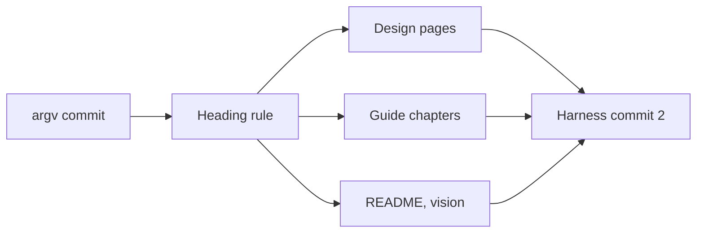

# Every heading is a section

The Engine stops knowing what an H1 is. One code path runs every section, and the walk has no branch for the start of a prompt.

## The rule

- **No heading is required.** Every heading, H1 to H6, starts a section.
- **The top level is the shallowest heading level in the file.** A heading is still at most one level deeper than its parent. The existing orphan check enforces both.
- **The preamble** is the text between the frontmatter and the first heading. If it holds a `lua` fence, it is the first top-level section and its name is empty. If it holds none, it is commentary.
- **A run starts at the first top-level entry** and falls through its siblings in file order. A deeper section runs only when Lua names it. This is today's walk.
- **A prompt has no title.** Where the Engine used the title, it uses the frontmatter `name`.
- **`argv` is read-only in every section.** A prompt that gets malformed input reads `args` and keeps what it builds in `var`.
- **Nothing else differs.** A Lua error anywhere is `lua_runtime`, every section entry reports its start and finish, and the first entry is `0.0`.

````markdown
---
name: research
description: d
runvil: 0
---

```lua
log("test")
```

## Research

```lua
return "chained with no jump"
```

````

- This runs the first block, then `Research`.
- `# Title` above `## A` and `## B` runs `Title` and returns `done`, because `A` and `B` are its children.

Basis: I traced each claim by reading the code and four surveys of the repositories. Nothing was built or run.

## Decisions I made where you left room

- **The word is "preamble".** The language spec already uses it for code before the first section, and "opening" collides with a fence's opening line. Confidence: medium - a naming call.
- **The preamble's name is the empty string.** A path step is never empty and a heading is never empty, so no path reaches it and no heading collides with it, with no extra code. `sys.section_name` and the events' `section` field are `""` there. Confidence: medium - a log shows an empty name.
- **Its Lua blocks get their label from the parser.** The parser passes the label where it builds the preamble, through the same parameter a heading uses. The first three lines below are the preamble's labels, and the last is a heading's, for comparison. Confidence: high - no branch.

````text
preamble prologue
preamble lua 2
preamble epilog
section `X` prologue
````

- **One wording branch.** A relative path that misses from the preamble says `the preamble has no child X`. Without it the message prints the preamble's address as `/`, which reads as the top level. Confidence: medium - say so if you want zero and I will drop it.
- **`argv` refusals read like `prose`'s.** The two texts are below. Confidence: medium - wording only.

````text
argv is read-only: assign to `var` or a section global instead
argv is read-only: cannot set field 'x'
````

- **A prompt with no sections starts like any other.** `start` loses its shortcut, the root chain finds nothing to enter, and `finish` returns `done`. Confidence: medium - traced by reading, and it now acquires the store scope first.
- **`sys.section_count` stays** as the number of top-level entries, the preamble included. Confidence: medium - I found no reader that depends on the old count.

## Engine, commit 1: `argv` is read-only

`runvil-lua`:

- [argv.rs](runvil-harness/crates/runvil-internal/lua/src/argv.rs): delete `Argv` and `install_writable`. The frozen install is the only one, with the new texts.
- [globals.rs](runvil-harness/crates/runvil-internal/lua/src/globals.rs) and [__impl_globals.lua](runvil-harness/crates/runvil-internal/lua/src/__impl_globals.lua): drop the `argv_frozen` slot. An assignment to `argv` always refuses.
- [vm/inject.rs](runvil-harness/crates/runvil-internal/lua/src/vm/inject.rs): `inject_values` takes an `Option<&Json>`. [vm/state.rs](runvil-harness/crates/runvil-internal/lua/src/vm/state.rs): delete `argv_json`.

`runvil-runtime`:

- [context.rs](runvil-harness/crates/runvil-internal/runtime/src/execute/context.rs): `vm_setup` loses `argv_writable`, and `with_walk_state` goes.
- [section_context.rs](runvil-harness/crates/runvil-internal/runtime/src/execute/section_context.rs): delete `read_argv`. [scheduler/h1.rs](runvil-harness/crates/runvil-internal/runtime/src/execute/scheduler/h1.rs): `end_h1` stops reading `argv` back.

Tests: the repair tests go (`lua/src/tests/argv.rs`, `globals-tests.rs`, `suite/args_surface.rs`, `suite/global_metatable.rs`, `tests/require/environment.rs`), and the refusal texts change.

## Engine, commit 2: every heading is a section

`runvil-prompt`:

- [parse.rs](runvil-harness/crates/runvil-internal/prompt/src/parse.rs): delete the H1 search and its three errors. The body becomes:

````rust
let headings = sections::collect_headings(body)?;
let top = headings.iter().map(|h| h.level).min().unwrap_or(1);
let mut walker = SectionWalker::new(&shared, &headings, frontmatter_lines, file);
let mut sections: Vec<Section> = walker.build_preamble(top)?.into_iter().collect();
sections.extend(walker.build_sections(top - 1)?);
````

- [sections.rs](runvil-harness/crates/runvil-internal/prompt/src/sections.rs) and [fence.rs](runvil-harness/crates/runvil-internal/prompt/src/fence.rs): one block builder that takes content, its line, and a location label. `build_preamble` returns a `Section` with an empty name and no children, or `None` when the text holds no Lua block.
- [prompt.rs](runvil-harness/crates/runvil-internal/prompt/src/prompt.rs) and [detail.rs](runvil-harness/crates/runvil-internal/prompt/src/detail.rs): delete `title`, `h1_blocks`, `Prompt::title()`, and `detail::h1_blocks`. A section's level is 1 through 6.
- [test_support.rs](runvil-harness/crates/runvil-internal/prompt/src/test_support.rs): `PromptSource` writes no title, and `.h1` and `.h1_prose` become `.preamble` and `.preamble_prose`.

`runvil-runtime`:

- **Deleted:** `scheduler/h1.rs`, `ChainKind::H1`, `is_h1`, `SectionContext::new_h1`, the gate remap, `reassign_tasks` with `TaskArena::reassign` and `EffectTable::reassign`.
- [drive.rs](runvil-harness/crates/runvil-internal/runtime/src/execute/scheduler/drive.rs): `start` always starts the root walk. [walk.rs](runvil-harness/crates/runvil-internal/runtime/src/execute/scheduler/walk.rs): default counters and one `enter_section` path.
- [step.rs](runvil-harness/crates/runvil-internal/runtime/src/execute/scheduler/step.rs): no `is_h1` parameter and no H1 arms. [chain.rs](runvil-harness/crates/runvil-internal/runtime/src/execute/scheduler/chain.rs): `finish` always arms completion, and `start_root_chain` folds into its one caller.
- [chain_record.rs](runvil-harness/crates/runvil-internal/runtime/src/execute/scheduler/chain_record.rs): `blocks` and `section_name` have one path.
- [section_path.rs](runvil-harness/crates/runvil-internal/runtime/src/section_path.rs) and [walk_target.rs](runvil-harness/crates/runvil-internal/runtime/src/execute/walk_target.rs): delete `Origin`. A relative path starts at a `SectionPos`, and a path from the top starts at the top-level list.
- **The frontmatter `name` replaces `prompt.title()`** in `drive.rs` (run start and end), `scheduler.rs` (`prompt_origin`), `section_pos.rs` (`name`), `inbox.rs`, and `test_hooks.rs`.

Elsewhere:

- [error.rs](runvil-harness/crates/runvil-internal/types/src/error.rs): the `StructureInvalid` doc and prose. [event.rs](runvil-harness/crates/runvil-internal/types/src/event.rs): doc lines.
- Both `public-api.txt` listings lose `Prompt::title`, regenerated with `xtask api --bless`.
- Comments and crate docs that describe the H1 are rewritten to describe what is there, in about 45 files. They say nothing about what used to be.

## Tests

- **Builders lose the title:** `PromptSource` and `prompt`, `sections` in `tests/scheduler.rs`, `context::parse`, the engine suite's `prompt`, the runner's `prompt` and its local constants.
- **357 inline prompts have a `# Title` line:** runtime 237, runner 55, prompt 54, `runvil` 7, engine 2, test-plugin 1, gateway-client 1. A scratch script removes the title and its blank line for the two common shapes (334). The other 23 are edited by hand.
- **What moves with it:**
  - Every later prompt line is 2 lower: about 150 assertions in about 45 files.
  - Root entry ids drop by one: about 33 assertions. Child chain and task ids stay.
  - A name that was the title becomes the frontmatter `name`: about 30 assertions.
- **H1 test files become preamble test files:** `tests/scheduler/h1/`, `suite/exec_flow/h1_control.rs`, `prompt/src/tests/h1_fences.rs`. Tests of a rule that still holds are rewritten for the preamble. Roughly 35 tests of a deleted rule go.
- **New parser tests:**
  - No heading with a Lua block, no heading without one, a prose-only preamble, a preamble above headings.
  - The top level at `#`, at `##`, and at `###`.
  - A deeper first heading with a later shallower one fails as an orphan.
  - Several H1s are siblings, and an empty heading fails at every level.
- **New run tests:**
  - The example above chains with no jump.
  - `var`, the model, the task limit, and a spawned task pass from the preamble to the next section.
  - A preamble `return` ends the run, and a preamble error is `lua_runtime` on its line.
  - `sys.id` is `0.0` in the first entry with and without a preamble.
  - The preamble reports its start and finish.
  - `jump('../X')` works from the preamble, and `call('X')` misses with the preamble wording.
  - `# A` above `## B` runs `B` only when `A` names it.
  - `argv` refuses a write in every section.

## Prompts and fixtures

- **24 prompt files** lose their title line: 5 in `prompts/`, 14 runtime fixtures, 5 engine fixtures. A description paragraph stays as commentary.
- `log-checkpoints.md` keeps its first block as the preamble.
- `missing-h1.md` parses now. It is replaced by `orphan-heading.md`, which holds `## Run` and then `# Late`.
- The `greeter` and `run-prompt` examples, the bench, and [prompt/README.md](runvil-harness/crates/runvil-internal/prompt/README.md).

## Design pages: `runvil-design`, one commit

- **Living:** `decisions/*.md` and the language spec. Dated records stay as they are: `design/2026-*`, `research/`, and the three top-level reports.
- [prompt-language.md](runvil-design/decisions/prompt-language.md):
  - The summary, the walk-through, and the entries at lines 29, 51, 105, 111, 117, 123, 197, 203, 209, 247, and 269 state the new rule in place.
  - Question 6 goes.
  - The header gets an `Update:` bullet, and section 11 gets a dated bullet that states the old rules, as the return rule did.
- **Reasons:** the two owner quotes that tie `argv` to the H1 (lines 201 and 213) go with the rules they justify. New reasons quote this conversation word for word, such as "I value uniformity over everything else." and "every prompt has a beginning, and we simply start there".
- **Other pages:** `engine.md` (116, 150, question 1), `tasks-and-fanout.md` (48, 152, 166), `models-and-conversations.md` (60, 66, 160), `files-and-the-vfs.md` (30), `shipped-prompts.md` (the five sample prompts and line 50), and the counts in `decisions/README.md`.
- [architect-runvil-prompting-language.md](runvil-design/design/architect-runvil-prompting-language.md): Source syntax (the sample and lines 85 to 89), the chain list and model start (223, 225), what the top level is (429), and the three recipes with a `# Title`.
- **Flag:** the spec's `tools.bind` and `tools.always` are H1-only and describe functions the Engine does not have. I reword "H1" to "the preamble" there and change nothing else. Confidence: medium - whether they stay is your call.

## Guide: `runvil-docs`, one commit

- **Scale:** 17 chapters, 529 examples, 38 headings that name the H1, 66 links to 11 H1 anchors, and 96 examples with line numbers in their output.
- **Examples:**
  - Title above sections, no Lua under it (448): delete the title line.
  - Lua under the title with sections (36): the Lua becomes the preamble. A relative path from it gains `../` (7 examples).
  - Title with Lua only (28) or nothing (18): rewritten for what each one teaches. Most become frontmatter and one Lua block.
  - Every result and every quoted line number comes from a run of the built Engine.
- **New H2 anchors, fixed here so chapters can be written in parallel:** `02-file-structure.md#the-preamble`, `06-arguments.md#argv-is-read-only`, `08-jump-and-call.md#jump-and-call-from-the-preamble`.
- **Retargets:** links to `#the-h1-pass` go to `04-how-a-prompt-runs.md#the-section-walk` or to the preamble section. Links to `#the-h1-hard-gate` go with their sentences.
- **Chapters with structural work:**
  - 01: the parts of a prompt, the smallest prompt, the shipped prompts.
  - 02: "The preamble" replaces "The H1 title and H1 body". Heading levels, the top level, structure errors.
  - 04: the stages. The walk starts at the first top-level entry. "The H1 pass" folds into the section walk, "The H1 hard gate" goes, and so does its notice row.
  - 05: entry ids, `sys.section_name`, location labels.
  - 06: one section, "`argv` is read-only", replaces the three on repair and freezing. It teaches `args` and `var` for malformed input.
  - 08: "Jump and call from the preamble" and the not-found messages.
  - 16 and 17: heading messages, run codes, six quick-reference rows.
- **Lighter work:** 03, 07, 09, 10, 12, and 14 each rewrite one to three H1 sections. 11, 13, and 15 change title lines and single mentions.
- **Checks:**
  - A scratch program, grown from the one the return rule used:
    - parses every example
    - runs each one that needs no arguments, replies, or tools, and prints its result beside the documented one
    - reports any example whose top level is one section with children and no Lua
    - checks every anchor, because the site build ignores them
  - `cargo xtask site --books-only` from `runvil` with `RUNVIL_DOCS` set.
  - A grep for `H1`, `title`, `gate`, `repair`, `frozen`, and `section 0`, with each remaining hit read.

## Other documents, one commit each

- [README.md](runvil/README.md) in `runvil`: the `greet` sample (lines 42 to 65) and the sentence at line 67.
- [runvil-vision.md](runvil-classroom/runvil-vision.md): the same sample (lines 21 to 44).

## Left alone

- **`runvil-workshop`.** It pins the Harness by a pushed commit, so it changes when you move the pin. That commit needs:
  - the pin in `Cargo.toml`
  - `chat.md` without its `# Chat` line
  - 17 embedded test prompts without titles
  - `lifecycle.rs:156`, which asserts the title as a section name
  - the `return 'done'` fixture in `conversation.rs:155`, which would pass by accident
  - the chat prompt's sentences in `shipped-prompts.md` and `models-and-conversations.md`
- **`wg21-paperflow` and the student work in `runvil-classroom`.** Both build against the old Engine. One student prompt repairs `argv` under its title.
- **Dated records:** every `plan/` and `vibe/` folder, `runvil-docs/plans/`, and the `vibelight` fixtures.
- **The section-path backlog** in `prompt-language.md`, which `decisions/README.md` lists under "Still to update".

## Order, commits, and git



- The plan is copied to `runvil-harness/plan/2026-11-13-2-every-heading-is-a-section.plan.md` first, and commit 1 includes it.
- The heading-rule code is held uncommitted while the documents are written against the built Engine. It is committed last, so the plan copy records every todo as done and gains a section on what the build found.
- Harness commits end with `Plan: /plan/2026-11-13-2-every-heading-is-a-section.plan.md`. The other repositories' commits end with `Plan: runvil-harness/plan/2026-11-13-2-every-heading-is-a-section.plan.md`.
- Every commit stays local on `master`. Pushing is yours to call.
- A removed file is moved to `cabinet/_trash/`, which is the workspace rule.

**Parallel work:** once the Engine compiles, tests are fixed crate by crate in parallel. Once the code passes, the design pages, the 17 chapters (one subagent each), and the two small documents run in parallel.

## Verification

Before each Harness commit, every command in [AGENTS.md](runvil-harness/AGENTS.md): format, clippy, nextest, both doc builds, `cargo test -p build-xtask`, the wording check, `xtask api --check`, and dylint. Then two sweeps over `crates/` and `prompts/`:

- **Deleted names**, expecting no hit: `h1_blocks`, `ChainKind::H1`, `is_h1`, `new_h1`, `Origin::H1`, `start_h1`, `end_h1`, `Argv::`, `install_writable`, `argv_json`, `read_argv`, `with_walk_state`, `reassign_tasks`, `H1 pass`, `H1 gate`, `H1 body`, `outside H1`, `.title()`.
- **Wording**, over the added lines: `no longer`, `formerly`, `previously`, `used to`, `legacy`, `deprecat`, `migrat`.

A remaining `H1` is a heading level in a parser message, a Markdown block kind, or HTML.
