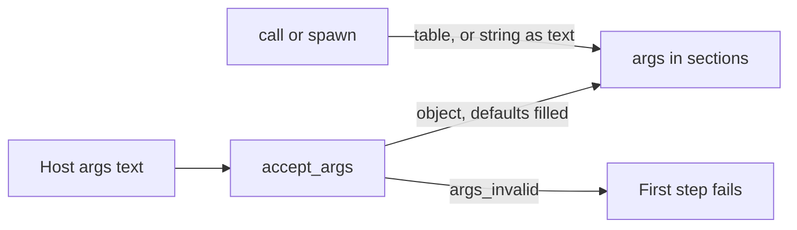
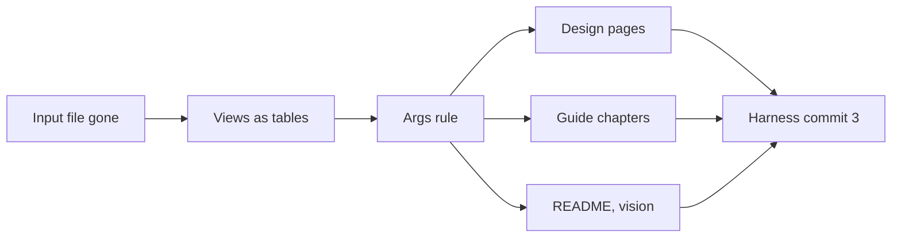

# A prompt's arguments are a JSON object

A caller passes a prompt one JSON object. The frontmatter key `args:` declares its shape, the Engine checks it before the first section runs, and the Lua global `args` holds the checked object. The input file, the four-type declaration, the raw argument string, and `argv` go. `output:` stays for the next plan.

Basis: five surveys of the repositories and my own reading of the code at `runvil-harness` `9dd953b5`. Nothing was built or run.

## The rule

- **The arguments are a JSON object.** Text that is not JSON, or JSON that is not an object, ends the run at its first step with the code `args_invalid`. A caller with nothing to pass sends `{}`.
- **`args:` declares the shape** as a subset of JSON Schema written in YAML. The keywords are `type` (`string`, `boolean`, `integer`, `number`, `array`, `object`), `properties`, `required`, `additionalProperties`, `items`, `enum`, `description`, and `default`. Any other keyword fails the parse.
- **Objects are closed.** A field the declaration does not list ends the run, unless its object says `additionalProperties: true`.
- **No `args:` key means one optional string named `text`.** A Host with plain text sends `{"text":"hello"}`.
- **A missing field that has a `default` is filled** before the check, at every depth.
- **`null` for a field that is not required counts as left out**, so a default fills it. `null` for a required field ends the run.
- **`args` holds the checked object**, read-only, in every section, and it is always a table. A placeholder reads a field as `{{ args.query }}`.
- **An `args` table behaves like the table it stands for**, except that it refuses a write. `#`, `pairs`, `next`, `ipairs`, `table.concat`, and `table.unpack` work on it, and it can be handed to `tools.call`, to `tasks.fanout`, to a spawn's `item`, and to `var`. A `var` table measures and iterates the same way.
- **`call(heading, args)` and `tasks.spawn(target, { args = ... })`** take a table of named fields, which becomes the child's `args`, or a string, which becomes `{ text = string }`. With neither, the child reads the caller's `args`.
- **One word everywhere:** the key `args:`, the global `args`, the `call` parameter, the spawn option, `TaskStarted.args`, and the code `args_invalid`. Rust already says `RunSetup.args` and `Run::new(prompt, args, params)`.
- **Deleted:** the input file (`input:` and `input_text`), the four-type `args:` declaration, the raw argument string, `argv`, and the `prose` wrap.

````markdown
---
name: search
description: Searches for papers on one query
runvil: 0
args:
  type: object
  properties:
    query: { type: string, description: What to search for }
    limit: { type: integer, default: 3 }
    depth: { type: string, enum: [quick, full] }
  required: [query]
---

## Search

```lua
return args.query .. ', limit ' .. args.limit
```
````

- `{"query":"papers"}` returns `papers, limit 3`.
- `{"query":5}` ends the run: ``argument `query` must be a string, got integer``.
- `{"query":"papers","n":2}` ends the run: ``argument `n` is not declared; the declared arguments are `depth`, `limit`, `query` ``.
- `papers` ends the run: `the arguments are not valid JSON`.



## Nothing is left behind

- **No compatibility code.** No alias, no fallback, and no code that recognizes a removed form.
- **An old prompt fails by the ordinary rules, with the ordinary message.** `input:` is an unknown frontmatter key, a field name written directly under `args:` is an unknown keyword, `argv` in Lua is an undefined global, and `{{ argv.x }}` is an unknown global. Nothing detects these cases, and no message names them.
- **No test names a removed form.** Tests cover the rule as it is, and a test of a deleted rule is deleted.
- **No text says what the rule replaced or why it changed.** That covers code comments, crate docs, READMEs, error messages, the guide, the design pages, the README sample, and the vision page. Each states the rule as it is.

## Decisions I made where you left room

- **Rust names that follow from `args` everywhere:** `ArgsSchema`, `Frontmatter::args()`, `accept_args`, `ErrorCode::ArgsInvalid`, and `TaskStarted.args`. Confidence: high - each is the same word.
- **A tool handler's parameter shadows the global.** Inside a handler written `function(args)`, `args` is that tool call's arguments, by Lua's own scoping. The Engine adds nothing for it, and guide chapter 12 says so in one sentence. Confidence: high - it is how Lua works.
- **The empty string is not valid, and the Harness default is `{}`.** One rule with no special case. Confidence: medium-high - it is the rule you stated, and a Host that passes nothing gets a valid empty object.
- **The code is `args_invalid`, number 705, and the check runs second**, after the version gate and before the store probe. Facts: `Reason` (`not_json`, `not_an_object`, `required`, `type`, `enum`, `undeclared`) and `Name` (the field, such as `focus[1]`). The error has no location, because bad arguments are the caller's gap, which is the rule `Requirements::refusal` follows. Confidence: medium on the code, low-medium on the order - no code depends on it.
- **The first mismatch is reported, in this order:** text that is not JSON, then JSON that is not an object, then each object's declared fields in name order, then its undeclared fields in name order. A declared field is checked for a missing required value, then a wrong type, then a value outside `enum`, then its own contents, and a list's items are checked in index order. Confidence: medium - a list of all mismatches saves a model a round trip, and can be added later.
- **The schema and its checker live in `runvil-prompt`**, in `contract/args.rs` and a new `contract/args_check.rs`. The runtime reaches the checker through `runvil_prompt::detail`. Confidence: medium - it keeps the keyword set in one crate, and adds `serde_json` to that crate's manifest.
- **`ArgsSchema` has one public method, `as_json()`.** It gives the schema as plain JSON Schema with `additionalProperties: false` written on each closed object, ready to publish as a tool's `inputSchema`. No key and a written copy of the default are equal. Confidence: medium.
- **Where JSON Schema leaves room, the subset is strict.** Confidence: medium on each.
  - Every node has a `type`, one word of the six.
  - An array has `items`.
  - `enum` is for `string` and `integer` fields only.
  - `null` is refused for a required field and inside a list, and it is kept inside an open object. `default: null` declares no default.
  - `integer` takes any JSON number with no fractional part that fits in 64 bits, and `args` holds it as an integer, so `5.0` and `1e3` read as `5` and `1000`.
  - A `default` must match its own node, checked at parse.
  - A keyword on the wrong type (such as `items` on a string) fails the parse.
  - Field names follow the name grammar, and `required` names only declared fields.
  - A repeated keyword fails the parse, and the root takes no `default` and no `enum`.
- **The check and the published schema agree.** Every value that is valid under `as_json()` passes, with one limit, that an integer must fit in 64 bits, and one allowance, `null` for a field that is not required. Confidence: high - each rule above was chosen for it.
- **Views measure and iterate through `__len` and the Engine's own `pairs` and `next`.** `read_only_proxy`, when its data is a table, and `var`'s `guarded_table` set `__len` to the data table's length, and `pairs` and `next` read through a view. A `__pairs` metamethod still wins. The walk hands back the view, never the hidden data table, so a view stays the only way to the data. Every read-only view whose data is a table iterates this way, a fanout result and a sealed Pack global included. Confidence: medium - nothing has run it, and tests that expect an empty walk change.
- **A child's args are not checked against the schema and get no defaults.** The schema describes what a caller passes the prompt, not what one section passes another. A list-shaped table is refused at the call: `args must be a table of named fields or a string, got a list`. Confidence: medium.
- **`TaskStarted.args` records the child's `args` as JSON.** Its doc says the payload is enough to start the chain again. Confidence: medium.
- **`{{ args }}` renders the whole object as compact JSON**, as every table placeholder does. Confidence: high - it is the existing rule for a table.
- **The message for an undeclared field lists the declared ones**, so a model can correct itself in one try. Confidence: medium - wording only.
- **An `args` table passes every Engine boundary as its data.** Today a read-only table converts as an empty one everywhere except `json.encode`, so `tools.call(id, args)` would send `{}` and `tasks.fanout(worker, args.files)` would fail as an empty collection. Each site that takes an author's table reads through the view. A table with no view inside converts exactly as it does today, messages included, and a table that contains itself is refused as it is today. Confidence: high on the need - the code's own comment says a view serializes empty - and medium on the fix, which nothing has run.
- **The default field's description is `Freeform text for this prompt`.** A published tool shows it for `text`. Confidence: medium - wording only.
- **Shipped prompts declare what they need.** `greet` takes a required `name`, `research-person` and `analyst-example` a required `text`, and `echo` uses the default. Confidence: medium - the README sample grows by four lines.

## Harness, commit 1: the input file goes

- [files.rs](runvil-harness/crates/harness-internal/runner/src/files.rs): delete `stage_input` and the reasons `input_undeclared` and `input_missing`. `read_output`, `report_output`, and their five tests stay.
- [setup.rs](runvil-harness/crates/harness-internal/runner/src/setup.rs): delete `input_text`.
- [prepare.rs](runvil-harness/crates/harness-internal/runner/src/prepare.rs): delete the staging block (lines 97 to 108). `prepare` can no longer fail, so it returns `(Run, RunPacks)`, and the two `Err` arms in [harness.rs](runvil-harness/crates/harness-internal/runner/src/harness.rs) (lines 225 to 237) go with it.
- [frontmatter.rs](runvil-harness/crates/runvil-internal/prompt/src/frontmatter.rs): delete the `input` field and `Frontmatter::input`. `FileDecl` stays for `output:`. From here on `input:` is an unknown key.
- **Tests:**
  - [prepare-files.rs](runvil-harness/crates/harness-internal/runner/tests/it/prepare-files.rs): the three refusal tests go with their rules. The other three keep their coverage with a file the Host seeds in the store: the output round trip, the store mounted away from the root, and the Host-seeded file.
  - A fixture that staged a file seeds it in the store from the Host, so the later commits leave it alone: `runner/tests/it/harness.rs`, `runvil/tests/suite/vfs.rs`, and `runtime/.../suite/vfs.rs`.
  - `runvil/tests/suite/launch.rs` and the `run-prompt` example are about a launch, so they take their text from the argument string.
  - `prompt/src/tests/frontmatter.rs` and `runvil-engine/tests/suite/prompt.rs` only declared the key, and they drop it.
- Doc lines in the runner's `lib.rs` and `recorder.rs` and in `runvil/src/lib.rs`. Both `public-api.txt` listings lose `RunSetup::input_text` and `Frontmatter::input` through `xtask api --bless`.

## Engine, commit 2: a view behaves like its table

A view is the empty stand-in an author holds for a read-only table or for a `var` table. This commit does not depend on the args rule, and it is made as soon as it passes.

- **Views measure:** `read_only_proxy` in [proxy.rs](runvil-harness/crates/runvil-internal/lua/src/proxy.rs), when its data is a table, and `guarded_table` in [var.rs](runvil-harness/crates/runvil-internal/lua/src/var.rs) set `__len`. The hardened `table.concat` already reads `#list` and `list[k]`, so it needs no change.
- **Views iterate:** `pairs` and `next` in [iteration.rs](runvil-harness/crates/runvil-internal/lua/src/iteration.rs) read through a view with `unseal`. A `__pairs` metamethod still wins, and the walk hands back the view.
- **An author's table is read through views before it is converted**, at six sites:
  - `tools.call` arguments (`protocol/parse/tools.rs`)
  - a spawn's `item` (`protocol/parse/tasks.rs`)
  - a `var` write (`var.rs`)
  - the fanout collection and its members (`collection.rs`)
  - a bare global in prose (`prose.rs`)
  - a message record (`messages.rs`)
- **One helper makes the plain copy.** It sits in `proxy.rs`, is built on `unseal`, and is modeled on `materialize_guarded_value`. It keeps the list marker, so an empty list stays `[]`, and it is held to the walk budget.
- **Tests:**
  - `#`, `pairs`, `next`, `table.concat`, and `table.unpack` on a `var` list and object and on an injected argument list and object.
  - `var.items[#var.items + 1] = x` and `table.insert(var.items, x)` append.
  - A write through the value `pairs` hands back is refused.
  - A `var` table handed to `tools.call`, to `tasks.fanout`, to a spawn's `item`, to another `var` field, and to a bare global in prose arrives as its data.
  - A table with no view inside converts as before, messages included, and a table that contains itself is refused as before.
  - Tests that expect `#` to be 0 or `pairs` to yield nothing on a view state the real length and entries.

## Engine and Harness, commit 3: the args rule

`runvil-types`:

- [error.rs](runvil-harness/crates/runvil-internal/types/src/error.rs): `ArgsInvalid = 705` with its tag, its parse arm, and its prose. `error-tests.rs` lists 69 codes, and `kind_of` in `lua/src/error_value.rs` gains the arm.
- [event.rs](runvil-harness/crates/runvil-internal/types/src/event.rs): `TaskStarted.input` becomes `args`, an `Option<serde_json::Value>`.

`runvil-prompt`:

- [contract/args.rs](runvil-harness/crates/runvil-internal/prompt/src/contract/args.rs) is rewritten. It holds `ArgsSchema` and its default, and `ArgsDecl`, `ArgDecl`, `ArgType`, and `ArgsDeclIter` are deleted. A streaming serde visitor builds the schema, so an error keeps its YAML path, line, and column:

````text
invalid frontmatter: args.properties.query: unknown keyword "tipe" at line 8 column 7
````

- Field names go through `deserialize_contract_map`, so the name grammar and the duplicate check stay in use.
- New `contract/args_check.rs` fills defaults and checks one JSON value.
- [detail.rs](runvil-harness/crates/runvil-internal/prompt/src/detail.rs): `accept_args(prompt, text)` returns the checked object or an `args_invalid` error, and `TEXT_FIELD` is `"text"`.
- `Frontmatter::args()` returns `&ArgsSchema`. `Cargo.toml` gains `serde_json`.

`runvil-runtime`:

- [context.rs](runvil-harness/crates/runvil-internal/runtime/src/execute/context.rs): delete `derive_argv` and the raw string. `ChainState::root` calls `accept_args`. `ChainState.args` is an `Arc<Value>`, the checked object, never optional. A failure is kept in `SharedState` beside `refusal`, with no location. `with_args(value)` wraps a string as `{ text }`.
- [drive.rs](runvil-harness/crates/runvil-internal/runtime/src/execute/scheduler/drive.rs): `check_start` returns that failure after the version gate. The docs there and in `run.rs` list four checks.
- [subst.rs](runvil-harness/crates/runvil-internal/runtime/src/subst.rs): the `args` root reads the object and takes a key path. Delete the `argv` root, `nil_argv`, and the refusal of `args.x`.
- `section_vm.rs`, `section_context.rs`, `scheduler/dispatch.rs`, `scheduler/tasks.rs`, `scheduler/admission.rs`: one `args` value, and a child's args are an `Option<Value>`.

`runvil-lua`:

- [argv.rs](runvil-harness/crates/runvil-internal/lua/src/argv.rs) is renamed `args.rs`. The `_G` guard in [globals.rs](runvil-harness/crates/runvil-internal/lua/src/globals.rs) and `__impl_globals.lua` serves `args`, and the refusal texts say `args is read-only`.
- [vm/inject.rs](runvil-harness/crates/runvil-internal/lua/src/vm/inject.rs): `inject_values` takes one `args: &Json`, and the raw global is no longer set.
- `RESERVED_NAMES` loses `argv` and has 62 entries.
- [protocol/parse.rs](runvil-harness/crates/runvil-internal/lua/src/protocol/parse.rs), `parse/tasks.rs`, `request.rs`, `__impl_coro.lua`, `__impl_tasks.lua`: the field is `args`, a table or a string. A table converts through `json::encode::to_json`, which reads through the read-only proxy, so `call(h, args)` passes the caller's arguments on.

Harness and facades:

- `RunSetup.args` defaults to `{}`.
- Both facades re-export `ArgsSchema` in place of the four `Arg*` types, and both `public-api.txt` listings are blessed.

Traps the surveys found:

- The wording check fails on a standalone "host" in Engine text, so no schema example there names a field `host`.
- Doc comments hold no doctests, so YAML examples get a non-Rust fence tag.
- The test prompt builder trims indentation, so nested YAML in tests is flow style or a hand-written source.
- A struct has at most 12 fields and a function at most 100 lines.
- `inject_values` has two `#[expect(clippy::similar_names)]` attributes for the `args` and `argv` pair. They go with the parameter, or clippy fails on an unfulfilled expectation.
- `runvil-prompt` gains `serde_json`, which changes `Cargo.lock`, and CI builds with `--locked`.

## Tests

These belong to commit 3. Commit 2 lists its own.

- **Defaults first.** `Scenario` in `runtime/src/test_support/scenario.rs` and in the engine suite, the 13 direct `Run::new` sites in the runtime, the 7 literal `""` sites in the runner and the gateway client, the bench, and the `greeter` example all pass `{}`. That keeps about 900 runtime tests and 120 Harness tests running.
- **Plain-text argument strings become objects.** Of 37 `.args(` sites in the runtime, 18 plain strings become `{"text": ...}` and 2 non-objects become refusal tests. The 3 engine-suite sites change the same way.
- **`args_surface.rs` (19 tests) is rewritten for the rule.** Tests of a deleted rule go: never errors on shape, a nil value, a scalar value, and the `prose` wrap.
- **`runvil-lua`:** `tests/argv.rs` becomes `tests/args.rs` without its nil and scalar cases, five test files read a field where they read the raw string, and the protocol parse tests gain table args.
- **`subst-tests.rs` (36 tests):** the `args` root tests read fields, and the tests of the `argv` root, `nil_argv`, and the refusal of `args.x` go.
- **New parser tests:**
  - Each keyword, and each refusal with its path, line, and column.
  - The default schema equals a written copy of it.
  - The published JSON of a declaration, as golden text.
- **New checker tests:**
  - Each type, `required`, an undeclared field, an open object, `enum`, nested objects, list items.
  - `5.0` and `1e3` for an integer, a number past 64 bits, and a default filled at depth.
  - `null` for a field that is not required, for a required field, inside a list, and inside an open object.
- **New run tests:**
  - Each first-step failure with its code, `Reason`, and `Name`, and with no location. No event is reported, and a set cancel flag wins.
  - `{}` runs a prompt with no `args:` key.
  - `call` with a table, with a string, with `args`, and with a list. `tasks.spawn` with each, and `TaskStarted.args`.
  - A fanout arm reads its caller's `args`.
  - Inside a tool handler written `function(args)`, `args` is the call's arguments.
  - An `args` table handed to `tools.call`, to `tasks.fanout`, to a spawn's `item`, to `var`, and to a bare global in prose arrives as its data.

## Prompts and examples

- `prompts/`: `greet`, `echo`, `research-person`, and `analyst-example` change as decided above. `hello` is unchanged.
- Four runtime fixtures read `args.text`: `prologue-return.md`, `store-fallthrough.md`, `prologue-prose-epilog.md`, `require-library.md`.
- The `run-prompt` example passes `{"text":"desk"}` and writes its greeting from `args.text`.
- `prompt/README.md` and the crate docs that describe the argument string, the wrap, or the input file state the rule as it is.

## Design pages: `runvil-design`, one commit

- [prompt-language.md](runvil-design/decisions/prompt-language.md):
  - The walk-through, the entry on frontmatter keys, and the entries on `call` and on the globals. The counts of keys, globals, and reserved names come from the built Engine.
  - All four entries of section 5.
  - The owner quote "there must be no freeform prompts" stays with the default declaration. The sentence on the name `prose` goes.
  - Each entry gives the reason for the rule as it stands:
    - A JSON object lets any prompt be published as an MCP tool, whose arguments are an object.
    - The declaration is JSON Schema because that is the form a tool publishes. It is a subset so that an unknown keyword fails the parse, which catches a misspelling.
    - An object is closed so that a misspelled optional field is refused, where an open object would drop it.
    - A default is filled because a caller that reads the schema expects it.
    - `null` for a field that is not required counts as left out because models send it that way, and the `std` Pack's checker reads it the same.
    - The name is `args` because it can only mean what the caller passed, where "input" could also mean what a user sends during the run.
    - The default field is `text`, the word for what a chain returns.
    - A read-only table is a stand-in because Lua calls `__newindex` only for a key the table does not hold.
  - The entries on `var` and on the read-only views state that a view measures and iterates like the table it stands for.
- **No page gains an `Update:` bullet or a dated bullet**, and no entry says what its rule replaced.
- **Other pages:**
  - `harness-and-host.md`: the staging entries, and `RunSetup`'s field count.
  - `files-and-the-vfs.md`: lines 90 and 146 to 148.
  - `engine.md`: four start checks, and what the Engine injects.
  - `tasks-and-fanout.md`: `tasks.spawn` and `TaskStarted`.
  - `decisions/README.md`: the counts.
- [architect-runvil-prompting-language.md](runvil-design/design/architect-runvil-prompting-language.md): the construct index, Source syntax, State and globals, `call`, and the three recipes that read `args` as a string.

## Guide: `runvil-docs`, one commit

- **Scale:** chapter 6 has 72 headings, and about 60 are deleted or rewritten. Across the guide, 25 example prompts declare `args:` in the four-type form, 3 declare an input file, 36 example runs pass plain text, 31 Lua lines and 44 placeholders read `args` as a string, and about 445 lines name `argv`.
- **Anchors, fixed here so chapters can be written in parallel:**
  - `06-arguments.md`: `#declaring-arguments-in-frontmatter`, `#argument-types`, `#required-arguments-defaults-and-descriptions`, `#declaration-errors`, `#argument-errors`, `#reading-arguments-from-args`, `#prompts-with-no-args-key`, `#args-is-read-only`, `#missing-fields-and-null-values`.
  - `02-file-structure.md`: `#the-output-file-declaration`. `#the-name-grammar-for-arg-names-and-adhoc-tool-names` is unchanged.
  - `07-substitution.md`: `#inserting-arguments-with-args`.
  - `08-jump-and-call.md`: `#call-args-and-var` and `#args-in-a-called-chain`.
  - Every link to an anchor that no longer exists goes to the one above that covers its subject. The checker's anchor pass finds each one.
- **No chapter mentions a removed form, a change, or a migration.** A section that taught a removed rule is deleted.
- **Chapters with structural work:**
  - 02: the key table, the contract keys, the input file sections.
  - 04: four start checks, and "Staging the input file" goes.
  - 05: "Reading arrays and other tables from `var`" and the `json.encode` example beside it state that `#`, `pairs`, and `table.concat` work on a `var` table.
  - 06: all of it.
  - 07: the `args` root takes a key path, and `NilArgv` and the `args` case of `NotATable` go.
  - 08: call args.
  - 12: one sentence on a handler's `args` parameter, and the reserved names.
  - 15: spawn args.
  - 16 and 17: the code tables and the key, global, and substitution rows.
- **Lighter work:** 01, 03, 10, and 14 change examples and single mentions.
- **Every result and message comes from a run of the built Engine.**
- **Checks:** the scratch guide checker (`guide-check-uniform-sections`) sends `{}` where it sent an empty string. Then `cargo xtask site --books-only` from `runvil` with `RUNVIL_DOCS` set, and a grep for `argv`, `argument string`, `wrap`, `input file`, `input text`, and `never enforced`, with each remaining hit read.

## Other documents, one commit each

- [README.md](runvil/README.md) in `runvil`: the `greet` sample (lines 42 to 63) and the sentence at line 65.
- [runvil-vision.md](runvil-classroom/runvil-vision.md): the same sample (lines 21 to 42).

## Left alone

- **`runvil-workshop`.** It pins the Harness by commit, so it changes when you move the pin. That commit needs:
  - the pin in `Cargo.toml`
  - the contract DTO in `server/src/routes/prompts.rs`: `args` becomes the schema JSON, and the input `FileDto` goes
  - `run-api.ts` and `run-rows.ts`: rows from the schema's properties, a JSON box for list and object fields, and no input-file row or Choose Input dialog
  - `prompts-tests.rs`, `run-api.mjs`, and `run-panel.mjs`
  - `workshop-app.md` and `workshop-ui.md` in `runvil-design`
  - Agent runs need nothing: `chat.md` reads no arguments, and the `RunSetup` default is `{}`.
- **`wg21-paperflow`.** Its vendored copy of the old Engine isolates it. `paperweight.md` and its launcher depend on the input file.
- **Student work in `runvil-classroom`.** Brazeal's prompt, kirill's two prompts, and kirill's runner use the raw argument string, `input:`, or `input_text`. Each builds against an older pin.
- **Dated records:** every `plan/` and `vibe/` folder, `research/`, and the untracked prompts under `runvil/local/`.
- **`output:`**, the store mount, and `execute`, which are later plans.

## Order, commits, and git



- The plan is copied to `runvil-harness/plan/2026-11-13-3-json-args.plan.md` first, and commit 1 includes it. The two research reports from this conversation (MCP tool schemas, Rust JSON Schema validators) are saved as research in the same step. They exist only in this chat, so that step needs the chat that wrote the plan.
- Commits 1 and 2 are made as each passes its checks. The args-rule code is held uncommitted while the documents are written against the built Engine. It is committed last, as commit 3, so the plan copy records every todo as done and gains a section on what the build found.
- Harness commits end with `Plan: /plan/2026-11-13-3-json-args.plan.md`. The other repositories' commits end with `Plan: runvil-harness/plan/2026-11-13-3-json-args.plan.md`.
- Every commit stays local on `master`. Pushing is yours to call.
- A removed file is moved to `cabinet/_trash/`.

**Parallel work:** in commit 3, `runvil-prompt` and `runvil-lua` change in parallel once the two `runvil-types` edits are in, and `runvil-runtime` follows both. Once the Engine compiles, tests are fixed crate by crate in parallel, and the guide checker is updated beside them. Once the code passes, the design pages, the guide chapters (one subagent each), and the two small documents run in parallel.

## Verification

Before each Harness commit, every command in [AGENTS.md](runvil-harness/AGENTS.md): format, clippy, nextest, both doc builds, `cargo test -p build-xtask`, the wording check, `xtask api --check`, and dylint. Then `cargo run -p runvil --example run-prompt`, which CI compiles but never runs, and three checks that CI adds to that list: `cargo doc -p runvil --no-deps`, the private-items doc build of `runvil-runtime`, and `cargo deny check`. Then three sweeps over `crates/` and `prompts/`:

- **Deleted names**, expecting no hit: `ArgsDecl`, `ArgDecl`, `ArgType`, `ArgsDeclIter`, `is_default`, `stage_input`, `input_text`, `input_undeclared`, `input_missing`, `derive_argv`, `nil_argv`, `argv`.
- **Wording**, over the added lines of every repository this plan touches: `no longer`, `formerly`, `previously`, `used to`, `legacy`, `deprecat`, `migrat`, `replaced`, `renamed`, `changed`.
- **`{{ args }}`**, over `prompts/` and every fixture: each hit is read, because the whole object renders as JSON where a field was meant.

## What the build found

The design held. The first build of the checker had four faults, and each was found and fixed before commit 3. These points differ from the plan above, or add to it.

The checker:

- **A required field that has a default takes the default.** The first build refused it as missing. A `null` for it is still refused, with or without the default. The test `a_required_field_with_a_default_takes_it_when_left_out_and_refuses_a_null` holds the rule.
- **A default is refused in the words of a default.** The first build refused a default that holds an undeclared field with the words for a run's arguments. The refusal now ends `this node declares no fields` or ``the declared fields of this node are `size` ``.
- **A `type` that is not one word has a message of its own.** `type: [string, integer]` fails with ``invalid type: sequence, expected one type word: `string`, `boolean`, `integer`, `number`, `array`, or `object` ``. An unknown word keeps the message ``unknown variant `text`, expected one of ...``.
- **An integer in an `enum` that is past 64 bits is named by its value.** The first build said that the list holds integers and that it holds an integer.
- **A number one past the smallest integer is refused.** A number that is not written as a 64-bit integer is read as a float. A float at either end of the 64-bit range is refused, because digits past the range round to that end. Below that, a float reads as the integer it holds, so `9223372036854775000.0` reads `9223372036854774784`.
- **A list item is counted from 0 in an argument error and from 1 in the refusal of a call's table.** `files[1]` names the second item of the caller's JSON, and `value.files[2]` names the second item of a Lua table.
- **The message for text that is not JSON has the JSON parser's reason after the plan's words**, as in `the arguments are not valid JSON: expected value at line 1 column 1`. The prose leaves the reason out.
- **A refusal is located where its node opens.** An unknown keyword and an unknown type word are located where they stand. A bad or a repeated argument name is located at the first name of its `properties` map, which is what `deserialize_contract_map` does for every contract map.
- **A scalar reads as a string where the declaration asks for a string**, so `description: 5` parses, as it does for every string of the frontmatter. `args:` with no value fails with ``a node needs a `type` ``, and `args: ~` fails with `invalid type: unit value, expected a map of schema keywords`.

The Engine:

- **`args` is served by the guard on `_G`.** It is not a raw key of the globals table.
- **`TaskStarted.args` is `None` for a chain that reads its spawner's `args`**, and a fanout arm is such a chain.
- **`tasks.spawn` ignores an option that it does not know.** `{ input = 'x' }` raises nothing, and the task reads its spawner's `args`.
- **`argv` reads nil, as any global that nothing set.** An index of it raises Lua's own error, and `{{ argv.x }}` fails with `unknown namespace or global 'argv'`.
- **`json.null` as the arguments of a call is named `lightuserdata`**, which is the Engine's word for it in every refusal of an argument.
- **`setmetatable(args, {})` raises a plain string**, `cannot change a protected metatable`, with no `kind` and no `code`. A refused write is an error value with the kind `lua` and the code `lua_runtime`.
- **`table.sort` on a list inside `args` raises only when it must move an item.**
- **The list that `tasks.fanout` returns is a plain table.** Each result in it is a read-only view.
- **The Engine installs 20 globals and reserves 62 names**, and `markdown` is one of the globals. `ErrorCode` has 69 codes.
- **Neither `public-api.txt` listing names `serde_yaml_ng`.** Its entry in the allowlist of `build-xtask` is unchanged.
- **`echo` returns `done` for `{}`**, because `return args.text` returns nil.
- **A task that holds the answer it waited for reports no block.** `tasks.status` read `blocked` as `chat` with the round already counted in `turns`, when a model reply and a timer both arrived before the next step. `Chain::blocked` now gives `None` for a chain that holds its answer, unless the chain waits for its slots.
- **The `var` guard refuses a key that JSON data has no place for, at the assigning line.** `var[true] = 1` passed the write and failed the run at the end of the block with a raw `deserialize error`, and `var[1] = 1` failed there as an internal fault. The root takes string keys alone. A table under it takes a string, or the index of an item it holds or of the next one.
- **A table that the conversion of a `var` write refuses is refused in the guard's words**, as in ``var.t must be JSON data: invalid type: boolean `true`, expected a string key``.
- **A `var` write still drops the named keys of a table that also has list items.** `var.t = { 'a', name = 'x' }` stores `["a"]` and raises nothing, where `json.encode` refuses such a table.

Tests and checks:

- **The whole workspace runs 3,781 tests, all passing.** It ran 3,653 after commit 2. `runvil-prompt` has 216 tests where it had 145, `runvil-runtime` has 1,213 where it had 1,179, `runvil-lua` has 799 where it had 796, the suite of `runvil-engine` has 46 where it had 41, and `harness-runner` has 175 where it had 173.
- **Seven test files are added:** `tests-args.rs` and `tests-args-check.rs` in `runvil-prompt`, `args_surface-chains.rs` and `args_surface-refusals.rs` in `runvil-runtime`, `parse_args.rs` in `runvil-lua`, `args.rs` in the suite of `runvil-engine`, and `prepare-args.rs` in `harness-runner`.
- **Every check listed under Verification passed on the final tree.** `cargo dylint` runs with `CARGO_BUILD_WARNINGS` unset, because the link step of the lint library gives a warning of its own.
- **The sweeps.** The deleted names have no hit. The wording sweep has one hit, `unchanged` in the description of `echo`. `{{ args }}` has nine hits, none in `prompts/`, and each one means the whole object.
- **No file is removed.** `argv.rs` and `tests/argv.rs` in `runvil-lua` are renamed to `args.rs` and `tests/args.rs`.
- **The runner and the gateway client had six literal `""` argument sites**, where the plan counted seven.

Documents:

- **The guide checker reads the arguments of an example from its lead-in**: the code span directly after the word "arguments", as in "Run it with the arguments `{"query":"papers"}`:". With no such span it sends `{}`.
- **The checker finds 536 examples in the 17 chapters, and 363 return their documented result.** Before the chapter work it found 540, and 317 returned theirs. Of the 25 that fail to parse, 24 teach a parse error and one is a Markdown sample that is no prompt. The 65 that differ each need a model reply, a Pack tool, a store file, or a Host that the checker does not have, and none of them is about arguments.
- **Chapter 6 has 18 examples, and all 18 match.** About 300 more runs stand behind its fragments and the results that its sentences state.
- **The guide links resolve.** The checker found 2,170 links in 30 files and no broken one, and `cargo xtask site --books-only` built both books with the 14 fixed anchors in them.
- **One agent edited chapters 1, 3, and 10**, which each needed a few lines, where the plan gave each chapter its own agent.
- **The statement on a sealed prelude table in chapter 12 is from the test `a_table_global_is_sealed_at_its_top_level`**, because the checker loads no Pack prelude. The codes of the errors, the place of the store check among the start checks, and the cancel rule are from the Engine's tests too, because the checker prints a failed run's message and not its code.
- **The guide names no field that the code lacks.** `sys.execution`, the `execution` field of an event, and the `name` and `prompt_hash` of a run's record are gone from it, and chapter 5 gives `must be JSON data` as the message of a refused `var` write. The design pages list 74 gaps where they listed 81.
- **The `status-snapshot` example of chapter 15 is right.** It shows `turns` as 0 while the model round is in flight, and the checker returns that text with its `--slow-model` option, which answers a round only when the run has no other work.
- **The design pages keep their counts of entries.** The page on the prompt language has 47 entries and the page on the Harness has 39, as before. One update bullet of `prompt-language.md` lost its words on `argv`. The `markdown` table is built, so that page lists it among the globals, says what its five functions do, and has no planned-work item for it.
- **Commits.** `6ef23a8e` and `8b7ad5f9` here are commits 1 and 2. `runvil-design` commits `f242554`, `e260e7c`, `95eaa9d`, and `4d99657`, `runvil-docs` commits `a525b76`, `beb2f3b`, and `48158dc`, `runvil` commit `003bebd1e`, and `runvil-classroom` commit `ce9f242` hold the document changes. Each is local on `master`.
