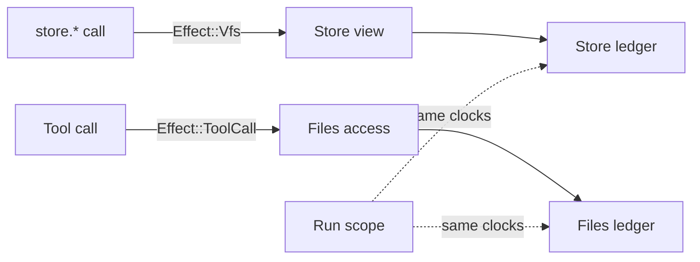
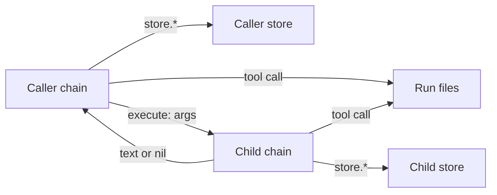

# The prompt returns its output, and the store is private to the run

Basis: two surveys of the repositories (the Harness and Host surface, and every user outside `runvil-harness`), my own reading of the vfs, runtime, lua, and runner crates on the current `master`, and the pending Execute Child Prompts plan, which this one is shaped to serve. Nothing was built or run.

## The rule

- **A prompt's output is its return value.** The `output:` key and `RunReport.output` go. A prompt that built a file returns its text, as in `return store.read('report.md')`. `RunReport` has `run_id`, `result`, and `unread`.
- **Every run starts with an empty store.** It is in memory, it belongs to that one run, and it is gone when the run ends. Every chain of the run shares it, as today.
- **The store is not in the run's filesystem.** No path of the `VfsRef` reaches it, `store.*` reaches nothing else, and a tool call's access sees none of it.
- **The caller has no way in.** Nothing seeds the store before a run and nothing reads it after. Data goes in as `args` and comes out as the result.
- **The claims rules stay.** Two chains with no order between them that touch one store path still end the run with a determinism error.
- **Stores share nothing.** Each store has its own files and its own claims ledger, so two stores have no path and no claim in common, even under one identity. A run has one store, and `execute` and `execute_async` later give each child prompt its own.
- **Store operations stay effects, and the run log is the only window on a store.** Every `store.*` call is `Effect::Vfs { access, op }`, answered with `perform_vfs_op`. The log holds each call's arguments and its outcome, in order, which is enough to rebuild the store at any point of the run. No effect is added, removed, or reshaped.
- **A prelude's install makes no store call.** The `store` functions suspend from the start, as `tools.call` does. A prelude chunk is not a coroutine, so a store call at its top level fails the prelude's load. A `pcall` around it catches the failure, and the store is untouched. A prelude may still capture `store` or one of its functions and call it from a function that a block calls later.
- **Deleted:** `output:`, `FileDecl`, `RunReport.output`, `read_output`, `ErrorCode::NoOutput`, `VfsRefBuilder::store`, `VfsRef::acquire_store`, `ScopeHandle::store_view`, `ScopeHandle::probe_store`, `VfsError::NoStore`, `ErrorCode::NoStore`, the run's start probe, the direct store closures with their conflict slot, `__impl_store.lua`, and `install_store_shims`.

## How a store keeps the claims system

The vfs crate already lets one scope record claims in more than one ledger. That is how a handle mounted inside another handle works: `VfsRef::acquire_with` joins the caller's scope, and `ClaimsTables.scopes` is keyed by a process-wide `ScopeId`. A store view uses the same join.

- **`Store` is a new type in `runvil-vfs`.** It wraps a private `VfsRef` over a fresh `MemoryBackend`: its own files, its own claims ledger, the `AllowAll` policy, and no op sink. `Store::new()` is its only constructor, and a clone is the same store.
- **`Store::view(access)` is the only way in.** It acquires on the store under `access`'s identity and scope. Forks, joins, and ends live in the `Scope`, which every ledger reads, so a store's happens-before order is the run's own.
- **Stores share nothing.** Two stores have separate backends and separate ledgers, and both are separate from the filesystem's. Path `notes.md` in one store never meets `notes.md` in another, or the file `/notes.md`. The scope's clocks are the one thing they have in common, and a clock holds no path.
- **Holding the `Store` is the whole authority.** The Engine makes the run's store in `ChainState::root` and never hands it out, so nothing outside the Engine can reach it. `Store` is in neither facade.
- **The scope handle is out of it.** `ScopeHandle::store_view` and `probe_store` go, and the handle keeps `spawn`, `join`, `end_access`, and `end`.

```rust
/// A store: an empty set of files in memory, under a claims ledger of its own.
#[derive(Clone)]
pub struct Store(VfsRef);

impl Store {
    pub fn new() -> Store {
        Store(VfsRef::new(MemoryBackend::new()))
    }

    /// A view of this store under `access`'s identity and scope.
    pub fn view(&self, access: &Access) -> Result<Access, VfsError> {
        let cx = AcquireContext::new(access.id, Arc::clone(&access.scope));
        let mut view = self.0.acquire_with(&cx, access.origin.clone())?;
        view.store_root = Some(VfsPath::root()); // strict paths, logical error paths
        Ok(view) // with its session wrapped in `StoreScoped`
    }
}
```



## Groundwork for `execute` and `execute_async`

The pending Execute Child Prompts plan gives each executed prompt its own store. With `Store` as a value, that is one line in the fork that switches a chain to another prompt, and the only edit to this plan's code is moving one field.

- **A child's store is `Store::new()`.** The fork that switches a chain's state to the child prompt sets a new store. The child's `call` chains and tasks clone that state, so they share the child's store, and a nested `execute` makes a third.
- **The child keeps its caller's file access.** It is the caller's own serial thread, as a `call` child is, so its tool calls on workspace files stay ordered after the caller's. A view is derived per store and per access, so one identity uses two stores with no cross-talk.
- **Caller and child see none of each other's paths or claims.** Separate backends hide the paths, and separate ledgers hide the claims. Two fanout arms that execute one child, which writes one path, both succeed with no extra rule.
- **`execute_async` is the same fork on a spawned task.** The task's own forked identity orders its file work against its spawner's, and its store is its own.
- **Every store view in the Engine comes from the chain's state.** `dispatch_vfs` is the one place that makes a store view, and it reads `ChainState::store()`, so a fork that swaps the store reaches every `store.*` call of that chain and its descendants.
- **Tool calls need nothing.** No tool sees any store, so a child's tool calls go through the chain's file access as they do today.



What the execute plan can drop or must change once this lands:

- **Its step 3 goes.** `ScopeHandle::fresh_store`, the forward that restores a mount's prefix, and the second claims table over the base's mounts are not needed. That plan calls this its most delicate part.
- **Its step 4 moves `store` from `SharedState` to `ChainState`**, beside the per-prompt bundle, and its step 5 sets a new `Store` in the fork where it called `fresh_store`.
- **Its "Files" rule shrinks** to "each execution gets a new store". The sentence that a child's tool calls use the child's store, the decision that the Host's policy and sink cover the child's store, and the test of a tool call reading a file the child wrote to its store go. Its test of a tool call under another mount stays.
- **Its `Vfs` records must name their store.** A blocking child shares its caller's task, so a record's task and sequence cannot tell the caller's `a.md` from the child's, and a debugger could not rebuild either store. This plan has one store per run and adds no field.
- **Its `output:` bullet goes**, and `check_start` has no store check to keep on the main prompt.
- **Its plan copy is the second of 2026-11-14**, so its file name takes `-2-`.

## Nothing is left behind

- **No compatibility code.** No alias, no fallback, and no code that recognizes a removed form.
- **An old prompt fails by the ordinary rule.** `output:` is an unknown frontmatter key, and no message names it.
- **No test names a removed form.** A test of a deleted rule is deleted.
- **No text says what the rule replaced.** Comments, crate docs, READMEs, error messages, design pages, and the guide state the rule as it is. Engine crate docs say "the caller", as `AGENTS.md` requires.

## Decisions I made where you left room

- **A store is a value, `Store`, in `runvil-vfs`.** Its one constructor makes an empty memory store, so that is the only kind there is, by construction. I first put the store inside `ScopeHandle`, one per scope, and dropped that: `execute` runs a child in its caller's scope under its caller's identity, so one scope must hold many stores. Confidence: medium-high - the join it relies on exists, but nothing has run it.
- **`Store` is in neither facade.** With `ScopeHandle::store_view` gone, no facade surface names it, and the facade shape check asks only that a surface item be re-exported. Confidence: high - read in `facade_shape.rs`.
- **Every chain of one prompt's run shares one store, wherever the field sits.** `Store` is a handle, and a cloned `ChainState` holds the same one, as it holds the same `args`. The field sits in `SharedState` here, read only through `ChainState::store()`, because `context.rs` puts a field there when every chain shares it. The execute plan moves it to `ChainState` beside the per-prompt bundle, where only the fork to another prompt sets a new one. Confidence: medium - either placement serves the execute plan.
- **Store operations stay effects, by design.** You want to debug a prompt, replay it, and watch its store change, and the effect path gives all three. The log holds every store call with its arguments and its outcome, in order. The caller sees each call before it happens, so a debugger can stop there. A replay re-issues the same effects and compares them. Running them inside the Engine would move that journal into a new event, lose the stopping points, and need a new rule for how a claims conflict stays uncatchable by `pcall`. A debugger rebuilds the store from the log and never reads through an effect's view, because a read under the chain's identity adds a claim. Confidence: high - the journal exists today and costs nothing to keep.
- **A prelude's store call fails the way its tool call does, with no new code path.** The store shims install with the other yield shims, so the call fails where it tries to suspend, and the load failure's fixed sentence names the store: "it must not call tools or the store while loading." The other choice, a dispatcher that raises a refusal of its own, buys a clearer first clause and keeps `__impl_store.lua` and the phase switch. Confidence: medium-high - `tools.call` in a prelude fails this way today, and a test pins it.
- **A refusal caught with `pcall` ends nothing.** The conflict slot exists because a caught conflict means a write already landed. A refused call touches nothing, so nothing is recorded out of band. Confidence: high - no store operation runs.
- **No shipped Pack has a Lua prelude**, in this repository, the Plugin repositories, or Workshop, so the refusal breaks no Pack. One runtime test and 34 lua tests rely on install-time or direct store calls. Confidence: high - a survey of every Pack definition.
- **The section VM holds no file access.** Its one use was the install-time store view, so `inject_values`, `vm_setup`, and `SectionContext::new` lose the access and the scope handle. Confidence: high - `install.rs` line 64 is the only reader.
- **Tools and the store are disjoint.** `std/read` and `bash` cannot see what `store.write` wrote, and `store.read` cannot see a mounted file. You confirmed this.
- **The Host's policy and op watcher never apply to a store.** That they applied to the declared store was a bug, and this removes it. Ask and Plan modes gate tool file changes only, and `on_op` reports tool file operations only. You confirmed this.
- **`VfsRef::default()` is one memory mount at `/` with nothing declared.** `RunSetup::new` and `RunParams::new` keep it as the files a run's tools work in. Confidence: high.
- **`NoOutput` (803) and `NoStore` (616) are deleted and their numbers retired.** Confidence: high - neither has a producer left.
- **`answer_vfs` loses its `catch_unwind`.** No foreign backend can run there, and the test that injected a panicking store has no way to exist. Confidence: medium.
- **The runtime's `TestStore` reads the run's own store.** A `#[cfg(test)]` accessor hands the scenario the run's `Store`, and `read` and `glob` go through a view under a throwaway access, where they go through `acquire_store` today. The roughly 55 post-run assertions keep working as written. Confidence: medium-high - it is the same access pattern on another handle.
- **Harness tests hook the recorder where they hooked the store.** `stopping_store` and `sending_store` fire when the write's effect record is appended, which is the moment before the loop performs it. `HookedRecorder` in `harness-inbox.rs` is the model. Confidence: medium.
- **The names `Effect::Vfs`, `VfsOp`, and the `vfs_*` events stay.** Confidence: medium - a rename is cheap later and noise now.
- **A run that returns nothing still ends with `done`.** Confidence: high - unchanged.

## Commit 1: the output file goes

- [frontmatter.rs](runvil-harness/crates/runvil-internal/prompt/src/frontmatter.rs): delete `FileDecl`, the `output` field, and `Frontmatter::output`. Drop the re-exports in `runvil-prompt`, [runvil-engine/src/lib.rs](runvil-harness/crates/runvil-engine/src/lib.rs), and [runvil/src/lib.rs](runvil-harness/crates/runvil/src/lib.rs), and the word "files" from both `prompt` module docs.
- [files.rs](runvil-harness/crates/harness-internal/runner/src/files.rs): the whole file goes, with `pub mod files` in the runner's `lib.rs`.
- [harness.rs](runvil-harness/crates/harness-internal/runner/src/harness.rs): delete `RunReport.output`, `output_path`, the `report_output` call, and the `output` line of the early return. Reword the docs here, in `setup.rs`, and in the runner's `lib.rs` that speak of a declared output file.
- [error.rs](runvil-harness/crates/runvil-internal/types/src/error.rs): delete `ErrorCode::NoOutput` with its tag and prose, and its arm in the lua crate's `error_value.rs`.
- **Tests:**
  - Fixtures that declared `output:` return the text and assert on `report.result`: `SHOUTS` in `runvil/tests/suite/launch.rs`, `REVIEW` in `runvil/tests/suite/vfs.rs`, `GREET` in the `run-prompt` example, and `FILES` in the runner's `harness.rs` and `prepare-files.rs`.
  - `assert_not_completed` and its call sites go (`support.rs`, `harness.rs`, `prepare-args.rs`, `prepare-ready.rs`, `harness-errors.rs`).
  - The `files.rs` unit tests, the two `output` tests in `prompt/src/tests/frontmatter.rs`, the `output` assertion in `runvil-engine/tests/suite/prompt.rs`, and `MISSING_OUTPUT` with `extract_declared_output` in the runtime's `suite/vfs.rs` go.
- Bless both `public-api.txt` listings.

## Commit 2: a prelude's install makes no store call

This lands before the private store, so that commit never has to thread a `Store` through code that is about to go.

- [coro.rs](runvil-harness/crates/runvil-internal/lua/src/coro.rs): the shim install puts the shim chunk's `store` table in `_G` beside the other shims. `install_store_shims`, `STORE_REGISTRY`, and the store half of `stash_shims` go.
- [engine_globals_store.rs](runvil-harness/crates/runvil-internal/lua/src/engine_globals_store.rs): `install_store_table`, the direct closures with `StoreShared` and `StoreReporter`, `record_store_conflict`, `route_store_to_shims`, and the dispatcher program go, and `__impl_store.lua` goes with them. `run_store_op`, the read helpers, and the messages stay, under a module doc that says so.
- [vm.rs](runvil-harness/crates/runvil-internal/lua/src/vm.rs), [inject.rs](runvil-harness/crates/runvil-internal/lua/src/vm/inject.rs), and [install.rs](runvil-harness/crates/runvil-internal/lua/src/vm/install.rs): the `store_conflict` slot, `take_store_conflict`, `store_conflict_handle`, and the VM's held access go. `install_engine_globals` installs no `store` and takes no scope handle, and `inject_values` takes no access.
- [prelude.rs](runvil-harness/crates/runvil-internal/lua/src/prelude.rs): the load-failure sentence reads "A prelude only defines functions; it must not call tools or the store while loading."
- [section_vm.rs](runvil-harness/crates/runvil-internal/runtime/src/execute/section_vm.rs): the conflict check after `install_preludes` and the trailing `install_store_shims` call go, with `SectionVmSetup.access` and `SectionVmSetup.scope`.
- [context.rs](runvil-harness/crates/runvil-internal/runtime/src/execute/context.rs), [section_context.rs](runvil-harness/crates/runvil-internal/runtime/src/execute/section_context.rs), and [walk.rs](runvil-harness/crates/runvil-internal/runtime/src/execute/scheduler/walk.rs): `vm_setup` and `SectionContext::new` lose the access and the scope handle. `SectionContext::new` is then at seven parameters, so its `too_many_arguments` expectation goes too.
- Docs: the lua and runtime READMEs, `runtime/src/lib.rs`, `protocol/request.rs`, `error_value.rs`, and the Engine definition in [AGENTS.md](runvil-harness/AGENTS.md), whose list of effects ends "a timer, or a store operation".
- **Tests:**
  - `preludes.rs` in the runtime: the conflict test goes. In its place, a prelude that calls the store while it installs fails the run before its first effect, with the new sentence. With `pcall` around the call, the prelude installs and a block finds the store empty.
  - New: a store function a prelude captured while it installed (`local write = store.write`) works when a block calls the prelude's function. Nothing tests that today.
  - The three tests that quote the load-failure sentence take the new one.
  - The lua test hub gains a block driver: it runs a chunk as a block and answers each store request with `run_store_op`. `run`, `run_with`, and `run_chunk` go through it, so the 25 tests in `tests/store.rs` keep their bodies and now cover the yield path, which the lua crate does not test today.
  - The four event tests in `store_reports.rs`, and the store-event halves of two tests each in `section_vm.rs` and `logging.rs`, move to the runtime's observation tests where it lacks them. The effect path reports those events there.
  - The conflict-slot tests, the dispatcher chunk-name test, and the tests of a store view that fails at install go, since no view is made there.

## Commit 3: the store is private

### runvil-vfs

- [store_view.rs](runvil-harness/crates/runvil-internal/vfs/src/handle/store_view.rs): add `Store` with `new` and `view`, as shown above. Delete `Access::store_view`, `probe_root`, and `trim_mount_error`. The strict path rules and `relativize_error` stay.
- [scope_handle.rs](runvil-harness/crates/runvil-internal/vfs/src/handle/scope_handle.rs): delete `store_view` and `probe_store`.
- [handle.rs](runvil-harness/crates/runvil-internal/vfs/src/handle.rs): delete `Volume.store` and `acquire_store`. `overlay` inherits nothing.
- [forward.rs](runvil-harness/crates/runvil-internal/vfs/src/handle/forward.rs): delete `StoreMount` and `StoreMountSession`. `StoreScoped` stays.
- [router.rs](runvil-harness/crates/runvil-internal/vfs/src/router.rs): delete `StoreDecl`, `VfsRefBuilder::store`, the builder's `store` field, and the `store` parameter of `from_router`.
- `error.rs`: delete `VfsError::NoStore`. `lib.rs`: export `Store`, and the `Default` impl, the crate doc, and the line in the crate's `AGENTS.md` state the new rule.

### Engine

- `runvil-types`: delete `ErrorCode::NoStore`.
- [context.rs](runvil-harness/crates/runvil-internal/runtime/src/execute/context.rs): `SharedState` gains `store: Store`, made in `ChainState::root`, with the accessor `ChainState::store()`.
- [dispatch.rs](runvil-harness/crates/runvil-internal/runtime/src/execute/scheduler/dispatch.rs): `dispatch_vfs` derives the view with `self.chain.ctx.store().view(&access)`, so it needs no scope handle. After commit 2 it is the one place in the Engine that makes a store view.
- [engine_globals_store.rs](runvil-harness/crates/runvil-internal/lua/src/engine_globals_store.rs): delete `NO_STORE_MESSAGE` and the `NoStore` arms. `error_value.rs` loses its `NoStore` mapping.
- [drive.rs](runvil-harness/crates/runvil-internal/runtime/src/execute/scheduler/drive.rs): `check_start` drops the store probe, so the order is the version gate, the args, then the requirements.
- Docs: `Effect::Vfs` in `run/effect.rs`, `dispatch_vfs`, `RunParams::with_vfs` and `RunParams::new` in `params.rs`, the runtime README, and the `vfs` module doc in `runvil-engine` say the store is the run's own and the `VfsRef` holds the files tools work in.

### Harness

- [effect_loop.rs](runvil-harness/crates/harness-internal/runner/src/effect_loop.rs): `answer_vfs` calls `perform_vfs_op` directly, and the module doc drops the real-disk and panic sentences.
- `setup.rs`, the runner's `lib.rs` and README, and the `vfs` module doc in `runvil/src/lib.rs`: `RunSetup::vfs` is the files the run's tools work in.

### Tests

- **vfs:** `scope_handle-tests.rs` is rewritten around the rule. The store-builder tests in `router-tests.rs`, the store on a real directory in `real/tests/semantics.rs`, and every `NoStore` and probe test go. Other fixtures use `mount` where they used `store`.
- **lua:** the test hub's block driver and its `store_view` helper view a `Store` where they used the scope handle. The `NoStore` cases go.
- **runtime:** `TestStore` reads the run's own `Store` through the `#[cfg(test)]` accessor. The seed and extract tests in `suite/vfs.rs`, the failing and refusing store backends in `store_failures.rs` and `run_setup.rs`, and the "no store" hook in `test_hooks.rs` go. `tool_call_access.rs` is rewritten so one tool call hands a file to a later one.
- **runner:** `HookedBackend` goes. `stopping_store` and `sending_store` become recorder hooks. In `effect_loop-vfs.rs` the thread test and the panic test go, and the withdrawn-write test asserts on records alone. `prepare-files.rs` goes. Tests that read the store after a run return the text.
- **engine and facade suites:** the mode, watcher, and Host-edit conflict tests are re-aimed at a file a tool call touches through its access. `test-plugin/tests/it/run.rs` uses `mount`.
- **New tests, one rule each:**
  - a new store is empty, and a clone of it is the same store
  - a file at `/notes.md` in a handle is invisible to a store view, and a store file is invisible to a plain access
  - two stores viewed under one identity share no file: a write in one is absent from the other
  - two identities with no order between them write one path, each in its own store, with no conflict, and in one store they conflict
  - two forked identities that write one store path conflict, and a joined one does not
  - a fork of an identity views the same store, and its work there is ordered after its parent's earlier work
  - a store view refuses every operation once its scope ends
  - a run over a `VfsRef` that holds `/notes.md` sees `store.exists('notes.md')` as false
  - two runs over one `RunSetup::vfs` each start with an empty store
  - a run's records rebuild its store: its `Vfs` effect records with an `Ok` answer, applied in order to an empty memory handle with `perform_vfs_op`, give the files the run read back
- Bless both `public-api.txt` listings.

## Design pages: `runvil-design`, one commit

- `decisions/prompt-language.md`: the `output:` paragraphs go, and the return value is the output.
- `decisions/harness-and-host.md`: `RunReport` has three fields, and the declared-output sections go.
- `decisions/files-and-the-vfs.md`: the store is the run's own memory, outside the VFS, and the `VfsRef` is for tool files. The paragraph on the prelude-install phase goes.
- `decisions/engine.md`: the Engine performs three kinds of work itself, and the section setup has no store switch.
- `decisions/tools-and-packs.md`, `design/architect-runvil-prompting-language.md`, and the counts in `decisions/README.md`.

## Guide: `runvil-docs`, one commit

Every result and message comes from the built Engine, and the checker and site build pass.

- Chapter 02: the output file declaration section and its table rows go.
- Chapter 09: the Host stores, mounts beside the store, policies, and modes sections go. "Files outlive the run" and "Tools and the store" are rewritten to the rule.
- Chapter 12: "Store calls while a prelude loads" states that the call fails the prelude's load, and the load-failure sentence names the store.
- Chapters 01, 04, 05, 14, 15, 16, and 17: the lines on install-time store calls, `no_store`, `no_output`, seeded files, tools sharing files with the store, and the quick-reference rows.

## Other documents, one commit

- `runvil/AGENTS.md` and `runvil/README.md`: the Engine definition's list of effects, as in this repository's `AGENTS.md`.

## Left alone

- **`runvil-workshop`.** It pins the Harness by commit. The pin-bump commit needs the `output` field out of the contract DTO in `server/src/routes/prompts.rs`, `run-api.ts`, and `run-rows.ts` in one change (the UI rejects a contract with the key missing), their tests, `workshop-app.md`, and the Engine definition in its `AGENTS.md`.
- **The Plugin repositories.** `std` and `bash` keep reading the run's files and need no code change.
- **`wg21-paperflow` and student work in `runvil-classroom`.** Each builds against an older pin.
- **Dated records:** every `plan/` and `vibe/` folder, `research/`, `.vibelight/md/`, and the prompts under `runvil/local/`.
- **`execute` and `execute_async`.** The Execute Child Prompts plan builds them on this one, and this plan edits neither that plan nor any code it adds.
- **Later plans:** a replayer and a store debugger over the log, and renaming `Vfs`.

## Order, commits, and git

- This plan is copied to `runvil-harness/plan/2026-11-14-1-private-store.plan.md` first, and commit 1 includes it. The two survey reports from this conversation are saved as research in the same step, which needs the chat that wrote the plan.
- This plan lands before the Execute Child Prompts plan, which takes the next number of the day.
- Commits 1 and 2 are made as each passes its checks. Commit 3 is held while the design pages and guide are written against the built Engine, then made last with the plan copy's todos marked done and a section on what the build found.
- Harness commits end with `Plan: /plan/2026-11-14-1-private-store.plan.md`. The other repositories' commits end with `Plan: runvil-harness/plan/2026-11-14-1-private-store.plan.md`.
- Every commit stays local on `master`. Pushing is yours to call. A removed file is moved to `cabinet/_trash/`.

**Parallel work:** in commit 1, the prompt, types, and runner edits are independent. Commit 2 is the lua crate first, then the runtime, then the tests of both in parallel. In commit 3, `runvil-vfs` goes first because everything builds on it, then the runtime and Harness edits run in parallel, then tests are fixed crate by crate in parallel. The design pages, the guide chapters, and the other documents run in parallel once the code passes.

## Verification

Before each Harness commit, every command in [AGENTS.md](runvil-harness/AGENTS.md), then `cargo run -p runvil --example run-prompt`, `cargo doc -p runvil --no-deps`, the private-items doc build of `runvil-runtime`, and `cargo deny check`. Then two sweeps over `crates/` and `prompts/`:

- **Deleted names**, expecting no hit: `FileDecl`, `read_output`, `report_output`, `NoOutput`, `no_output`, `acquire_store`, `probe_store`, `probe_root`, `StoreDecl`, `StoreMount`, `trim_mount_error`, `NoStore`, `no_store`, `HookedBackend`, `install_store_table`, `install_store_shims`, `route_store_to_shims`, `store_conflict`, `STORE_PHASE_REGISTRY`, `__impl_store`, and `output:` as a frontmatter line in any fixture.
- **Wording**, over the added lines of every repository this plan touches: `no longer`, `formerly`, `previously`, `used to`, `legacy`, `deprecat`, `migrat`, `replaced`, `renamed`, `changed`.
