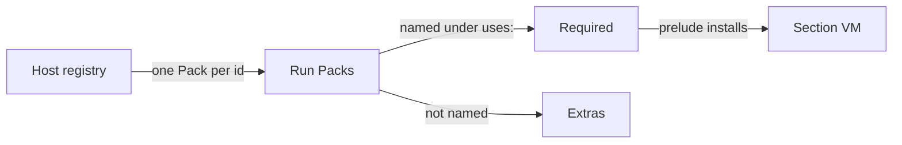

# Every installed Pack is in every run

Basis: read at `runvil-harness` `b92fdb3b`. Nothing was built or run.

## The rule

- **The Host decides a run's Packs.** Every run holds every Pack the Host installed. No prompt changes which.
- **One Pack per Pack id.** The registry refuses a Pack whose id it already holds, whatever the vendor, so `runvil/web` and `acme/web` are never both installed.
- **`uses:` marks what a prompt requires.** A required Pack that is missing or cannot serve refuses the run, and its prelude installs in every section. Every other Pack is an extra: no prelude, and a section may still offer or call its tools.
- **The `runvil` vendor does one thing.** A bare `uses:` entry means `runvil/<id>`, and another vendor's Pack is written `vendor/name`. An entry the Host holds under another vendor is refused, as it is today.
- **A run waits for every Pack to be ready**, as it waits today for each Pack it holds.

## What it changes for a Host and an author

- **Another vendor's Pack is an extra in every run.** `tools.packs.extras()` lists it, `tools.call` reaches its tools by id with no `uses:` entry, and a section that offers its extras offers it.
- **Every run makes an instance of every installed Pack** and waits for it. The Pack contract already says `ready` resolves within a bound the Pack owns.
- **The second Pack inserted under an id is refused at install.** The first keeps the id. No shipped Pack shares one: `web`, `mcp`, `std`, `bash`, `subagents`, `user`.

## Decisions I made where you left room

- **One refusal, `pack_id_taken`, covers every held id.** It replaces `reserved_name`, which refuses only a built-in's id, and its message names the Pack that holds the id (medium confidence - a naming call).
- **A Pack whose id an unserved `uses:` entry names is left out of that run.** A prompt that names `acme/web` on a Host with `runvil/web` gets a roster that says `web` is unavailable, with the reason. If `runvil/web` stayed in, the catalog would list tools of a Pack the roster calls unavailable (high confidence - read in `RunPacks::snapshot`).
- **The run waits on every Pack.** A Pack that breaks its `ready` bound stalls every run of the Host, where today it stalls only runs that hold it (medium confidence - it is one rule for every Pack, and the bound is the Pack's duty by contract; say so if extras should not be waited on).
- **Two Packs whose tools share a wire name are not refused at install.** A section that offers both fails at that offer, as it does today (medium confidence - the registry sees no tools).
- **The Engine does not change.** It already marks a prompt's own `uses:` as required and every other Pack on the roster as an extra, and it checks a declared Pack by id (high confidence - `declared` has two readers, both in `runvil-lua`'s `packs.rs`).

## Code: one commit in `runvil-harness`

The two crates change together: with one Pack per id and the old pick, or the new pick and two Packs per id, the runner's tests do not pass.

`runvil-plugin`:

- [registry.rs](runvil-harness/crates/runvil-plugin/src/registry.rs): `add` refuses an id the registry holds, with the reason `pack_id_taken`, after its checks for a bad name, a repeated name, and a reserved id. `reserves` and the `reserved_name` refusal go. The docs of `PackRegistry`, `insert`, and `BUILTIN` state the rule.

`harness-runner`:

- [packs.rs](runvil-harness/crates/harness-internal/runner/src/packs.rs):
  - `pick` resolves each `uses:` entry as today, then takes every installed Pack whose id no unresolved entry names.
  - `find` names the one other Pack that holds the id, where it joins several today.
  - The module doc, the `RUNVIL` constant's doc, and the docs of `Picked`, `pick`, and `snapshot` state the rule. `make`, `wait_ready`, `snapshot`, `refusals`, and `preludes` keep their code.
- [lib.rs](runvil-harness/crates/harness-internal/runner/src/lib.rs): the two invariants on what the registry refuses and which Packs a run holds.

The plugin loader needs no change: it already reports a Pack the registry refuses and inserts the Plugin's other Packs.

## Tests

- **`registry-tests.rs`:**
  - `add_accepts_a_pack_whose_id_another_vendor_has` is replaced by a refusal that names the holder.
  - The test of a built-in's id asserts the new reason.
  - New: a Pack inserted unavailable holds its id too.
- **`packs-tests-pick.rs`:** rewritten around the rule. Its `vendors` fixture installs two `web` Packs and goes.
  - A run that declares nothing holds every installed Pack, another vendor's included.
  - A declared Pack is required, and every other is an extra.
  - `acme/web` named on a Host with `runvil/web`: the roster says `web` is unavailable with the reason, and the catalog holds no `web` tool.
  - A bare `web` on a Host with only `acme/web` is refused naming `acme/web`.
  - The ready wait covers every installed Pack.
- **`prepare.rs`:** `an_undeclared_third_party_pack_is_not_in_the_run` becomes a test that its tool is reached by id and its prelude is not installed.
- **`prepare-ready.rs`:** `an_undeclared_third_party_pack_that_never_gets_ready_holds_no_run_up` goes. The tests of an undeclared Pack whose `ready` fails, and of a cancel during the wait, cover another vendor's Pack as well.
- **Elsewhere:** tests in `packs-tests.rs`, `host-tests.rs`, the loader, and `runvil/tests/suite` that rely on the old pick or on two vendors of one id are re-aimed. A test of a deleted rule is deleted.

## Documents: one commit each

Written once the code passes, each stating the rule as it is.

- **`runvil-design`:** in [tools-and-packs.md](runvil-design/decisions/tools-and-packs.md), the sentence that a declared Pack replaces `runvil/web`, and the section "A run includes every `runvil` Pack". The counts in `decisions/README.md` if they change.
- **`runvil-docs`:** chapter 12 (the catalog, extras, `tools.get`, `tools.packs`), chapter 4 (the pick, the ready wait, the catalog, the requirements check), chapter 1 (the Harness's catalog), and chapter 13 (reaching the web tools). Example values come from the built Engine, and `cargo xtask site --books-only` builds the books.
- **`runvil-classroom`:** the line in [tutorial-plugin-architecture.md](runvil-classroom/tutorials/tutorial-plugin-architecture.md) that says a run holds another vendor's Pack only when the prompt declares it.

## Left alone

- **`runvil-workshop`.** It pins the Harness by commit. Its pin bump needs the test in `server/src/agents/tests.rs` that says a run holds every `runvil` Pack.
- **The Plugin repositories.** Each ships one Pack with an id of its own.
- **Dated records:** every `plan/` and `vibe/` folder, and `research/`.
- **The Execute Child Prompts plan.** It is reviewed again once this is in the source, and its plan copy takes the next number of the day.

## Verification and git

- Every command in [AGENTS.md](runvil-harness/AGENTS.md) passes before the commit. Neither `public-api.txt` listing changes, because no signature does.
- Two sweeps over `crates/`: no `"reserved_name"` reason and no `reserves(` in `runvil-plugin`, and none of `no longer`, `formerly`, `previously`, `used to` in the added lines.
- This plan is copied to `runvil-harness/plan/2026-11-14-2-every-pack-in-every-run.plan.md` first. The code commit includes it, with its todos marked done and a section on what the build found, and ends with `Plan: /plan/2026-11-14-2-every-pack-in-every-run.plan.md`. The other repositories' commits end with `Plan: runvil-harness/plan/2026-11-14-2-every-pack-in-every-run.plan.md`.
- Commits go on `master`. Pushing is yours to call.

## Order

- The registry and the pick are written together, then their tests.
- The three document commits need the built code and do not depend on each other.
- The `runvil-harness` commit is made last, so its plan copy records the document commits.

## What the build found

The design held, and the Engine did not change: no file under `runvil-internal` or `runvil-engine` is in the commit. These points differ from the plan above, or add to it.

The registry and the pick:

- **One refusal names the holder.** `holder` in `registry.rs` returns the fully qualified name of the Pack that holds an id, a built-in or any other, in the place of `reserves`. The message is ``Pack `acme/web` cannot take the Pack id web, which `runvil/web` holds``, and a built-in's id gets the same text, as in ``which `runvil/subagents` holds``.
- **A Pack inserted unavailable holds its id.** A later insert under that id is refused, whichever of the two inserts is the unavailable one.
- **The pick keeps the declared Packs first.** The entries the Host can resolve come first, in declaration order, then every other installed Pack in the order of the fully qualified names. `RunPacks::snapshot` reads its input in that order, as before.
- **Only a refused run leaves a Pack out.** A run leaves out a Pack when a `uses:` entry names its Pack id under a vendor the Host did not install it from. The first step of that run refuses it, and `Host::parse` refuses the prompt before any run. So every run that starts holds every installed Pack, which is how the doc of `PackRegistry` states the rule.
- **Two more crate docs changed.** The crate doc of `runvil-plugin` says that the registry holds one Pack per Pack id. The crate doc of `plugin-web` said that a run holds the web tools "unless it declares another vendor's `web`", and that clause is gone.
- **The plugin loader needed no change**, as the plan expected.

Tests:

- **No test outside `runvil-plugin` and `harness-runner` failed under the rule.** The plan expected tests of the loader, of `host-tests.rs`, and of `runvil/tests/suite` to need a new aim. None of them installs two vendors under one Pack id, and none relies on an undeclared Pack being absent.
- **Four tests of `packs-tests.rs` have a new aim.** `each_snapshot_makes_each_pack_the_run_holds_once_and_each_run_gets_its_own_instance` installs `acme/kit`, so it shows that a run makes a Pack of another vendor that its prompt does not declare. `the_roster_hands_each_usable_pack_with_the_vendor_of_its_fqn` installs one `kit` Pack and expects the undeclared `acme/poop` on the roster. `a_pack_whose_id_an_unresolved_entry_names_is_never_made` is the one case of a Pack that a run does not make. `an_undeclared_packs_tools_reach_the_catalog_but_its_prelude_does_not` covers a Pack of another vendor beside the `runvil` one.
- **`packs-tests-pick.rs` has 12 tests where it had 10.** Its Host holds `runvil/web` and `acme/poop`. The two added tests are `the_pick_is_every_installed_pack_with_the_declared_ones_first` and `a_runs_roster_and_catalog_are_the_same_whatever_its_prompt_declares`.
- **`prepare-ready.rs` has one more test.** The test of a stuck Pack that holds no run up is gone. Two tests take its place: an undeclared Pack of another vendor that starts late has its tools in the run, and a cancel while that Pack is still starting ends the run as canceled. The two tests of an undeclared Pack whose `ready` fails run over `runvil/slow` and over `tests/slow`.
- **A Pack whose `ready` never resolves holds every run of its Host until a cancel.** `the_ready_wait_covers_every_pack_the_run_holds` pins the wait, and the cancel test pins the way out.
- **A doc comment in `tests/it/scripted.rs`** said that the hold Pack "reaches only a run that declares it". It now says what the function builds.
- **The whole workspace runs 3,795 tests, all passing, and skips 24.** It ran 3,791 before: one more in `runvil-plugin`, two more in `packs-tests-pick.rs`, and one more in `prepare-ready.rs`.
- **Every check listed under Verification passed on the final tree**, and so did `cargo run -p runvil --example run-prompt`. Both sweeps found no hit, and neither `public-api.txt` listing changed.

Documents:

- **A probe ran the guide's statements through the Harness.** The guide checker steps the Engine with no Pack roster, so it cannot show which Packs a run holds. A scratch program outside this repository, built on the `runvil` crate, runs one prompt on a Host whose registry holds the fixture Packs that its command line names, and prints each insert, the Host's parse, and the run's result.
- **The guide changed in six chapters, where the plan named four.** Chapters 5 and 17 had one sentence each: that a run "holds the `user` Pack only when it has a user", and that a Pack tool comes from "a Pack you declare". No heading, no example prompt, and no shown result changed.
- **The guide checker gives every example the verdict it gave before.** It finds 529 examples, and 362 return their documented result. It found 2,157 links and no broken one, and `cargo xtask site --books-only` built both books.
- **Two statements of the guide come from the Harness's tests**, because the probe cannot hold a Pack in its start and prints no events: that an undeclared Pack that is still starting delays a run, and that a tool event names the vendor of an undeclared Pack.
- **One difference between the guide and a Host stays.** The guide shows `- missing required Pack: web` for a bare entry that no Pack of the Host has, which is the line of the run's first step. `Host::parse` refuses that prompt first, with `- web is unavailable: runvil/web is not installed`. The design page lists this as its one known difference between the guide and the code.
- **The design page has one more entry.** "A registry holds one Pack for each Pack id" gives the refusal and its reason, so `tools-and-packs.md` has 62 entries and `decisions/README.md` counts 546.
- **The tutorial changed in two rules.** The rule that a declared `acme/web` takes the place of `runvil/web` was false too. The tutorial is a snapshot of `18361d02`, so its header names this change for those two rules.
- **Commits.** `runvil-design` commit `835ae52`, `runvil-docs` commit `2c3c39c`, and `runvil-classroom` commit `9dab771` hold the document changes. Each is local on `master`.