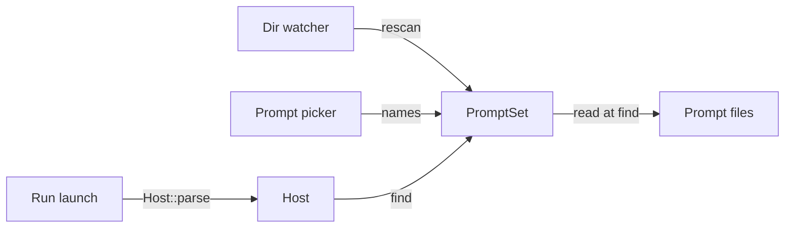

# Stock prompt finders for the Harness

Today every Host hand-writes a closure to serve its prompts. This adds three `PromptFinder` implementations a Host can use instead. The trait itself, in the Engine, is not touched.

## Settled with you

- A file is read at each `find`, with `std::fs::read_to_string`, so an edited prompt is picked up by the next find.
- Nothing is cached, neither the text nor a parsed prompt.
- The set lists a directory when it is added, and again whenever the Host calls `rescan`. The Host watches its directories. The set watches nothing.
- `rescan` keeps going past a directory it cannot list: that directory counts as empty, the others update, and `rescan` returns each failure.
- `names()` lists every prompt the set has an entry for, so a picker shows exactly what `find` serves.
- The two single finders are named `FindTextPrompt` and `FindFilePrompt`, so neither reads as a kind of `Prompt`.

## Where they go

- One new module, [prompt_finders.rs](runvil-harness/crates/harness-internal/runner/src/prompt_finders.rs), in `harness-runner`, beside `Host`, which is the type that holds the finder.
- Re-exported at `runvil::harness`, the same way `MemoryRecorder` is: a stock implementation of a trait the Host supplies.
- No new crate, no new dependency, no new `ErrorCode`.

## How a Host uses the set



A Host fills the set first, then shares it. There is one `PromptSet`, behind an `Arc`, and two handles to it:

- The `Host` holds one as `Arc<dyn PromptFinder>`, its `prompts` field. Through that type only `find` can be called.
- The application keeps the other as `Arc<PromptSet>`, so its directory watcher can call `rescan` and its picker can read `names`. Those methods are not on the trait, and the `Host`'s handle cannot be turned back into the concrete type.

```rust
let mut prompts = PromptSet::new();
prompts.insert_dir(&shipped_dir)?; // listed now
prompts.insert_dir(&user_dir)?;    // inserted later, so its files win
let prompts = Arc::new(prompts);   // filled, and from here on shared

// A second handle to the same set, not a copy of it.
let host = Arc::new(Host { packs, prompts: prompts.clone(), timer });

// Later, from the Host's directory watcher:
let failures = prompts.rescan(); // one Error per directory it could not list
let listed = prompts.names();    // what the picker shows
```

## The public API

These are the declarations and the doc comments as they will ship. Bodies are left out. The whole surface is 3 types, 3 constructors, 5 methods, and 3 `PromptFinder` impls. Every field is private, and the only derives are `Debug` and, on the set, `Default`, which clippy requires beside a `new` that takes nothing.

### Module docs

```rust
//! Stock prompt finders: [`FindTextPrompt`] serves one prompt from text,
//! [`FindFilePrompt`] serves one from a file, and [`PromptSet`] serves the
//! prompts a Host inserts as text, as files, and as directories.
//!
//! A file is read with a blocking `std::fs` call at each find, and
//! nothing is cached, so an edited prompt shows in the next find. The
//! Harness calls a finder only from `Host::parse`, before the run
//! exists, so no read happens inside a run's future.
```

### `FindTextPrompt`

```rust
/// Finds one prompt, whose source is the text it was built with.
///
/// A find for any other name fails as [`NotFound`](ErrorCode::NotFound),
/// with the message `no prompt named {name}` and the name as the
/// [`Name`](ErrorFact::Name) fact.
#[derive(Debug)]
pub struct FindTextPrompt {
    name: String,
    text: String,
}

impl FindTextPrompt {
    /// A finder that serves `text` as the source of the prompt `name`.
    #[must_use]
    pub fn new(name: impl Into<String>, text: impl Into<String>) -> FindTextPrompt;
}

impl PromptFinder for FindTextPrompt {
    fn find(&self, name: &str) -> Result<String, Error>;
}
```

### `FindFilePrompt`

```rust
/// Finds one prompt, whose source is a file read again at each find, so
/// a change to the file shows in the next find.
///
/// The read is a blocking `std::fs::read_to_string`. When it fails, the
/// find fails with the message `prompt {name}: cannot read {path}` and
/// the system's reason, the name as the [`Name`](ErrorFact::Name) fact,
/// and the path as the [`Path`](ErrorFact::Path) fact. Its code is
/// [`NotFound`](ErrorCode::NotFound) when the file does not exist,
/// [`NotUtf8`](ErrorCode::NotUtf8) when its contents are not UTF-8, and
/// [`Io`](ErrorCode::Io) otherwise.
///
/// A find for any other name reads nothing and fails as
/// [`FindTextPrompt`]'s does.
#[derive(Debug)]
pub struct FindFilePrompt {
    name: String,
    path: PathBuf,
}

impl FindFilePrompt {
    /// A finder that serves the file at `path` as the source of the
    /// prompt `name`. Nothing is read or checked until a find. A relative
    /// `path` resolves against the working directory of each find.
    #[must_use]
    pub fn new(name: impl Into<String>, path: impl Into<PathBuf>) -> FindFilePrompt;
}

impl PromptFinder for FindFilePrompt {
    fn find(&self, name: &str) -> Result<String, Error>;
}
```

### `PromptSet`

```rust
/// Finds the prompts a Host inserted: as text, as a file, or as every
/// prompt file in a directory.
///
/// A find takes the newest insert that has the name, so a later insert
/// wins over an earlier one. A Host that inserts its shipped directory
/// and then its user's directory serves the user's file under a name
/// both hold. A find for a name no insert has fails as [`FindTextPrompt`]'s
/// does.
///
/// A file is read again at each find, so a change to it shows in the
/// next find, and a read that fails is the find's failure, as
/// [`FindFilePrompt`]'s is. A directory is listed when it is inserted and
/// again at each [`rescan`](PromptSet::rescan), and not in between: a
/// file added to it is found after the next rescan, and a find for a
/// file removed from it fails with the read's failure until then,
/// without trying an older insert.
///
/// A Host fills the set, then shares it behind an `Arc`. One handle goes
/// into its `Host` as the finder. The Host keeps the other, to call
/// `rescan` when it sees a directory change and
/// [`names`](PromptSet::names) to list what the set serves. The set
/// watches no directory itself. A rescan changes what later finds
/// return, and never a run that has started, which holds its parsed
/// prompt.
///
/// Reads and listings are blocking `std::fs` calls.
#[derive(Debug, Default)]
pub struct PromptSet {
    /// One entry per insert, oldest first.
    entries: Vec<Entry>,
}

impl PromptSet {
    /// An empty set, which finds no prompt.
    #[must_use]
    pub fn new() -> PromptSet;

    /// Inserts `text` as the source of the prompt `name`.
    pub fn insert(&mut self, name: impl Into<String>, text: impl Into<String>);

    /// Inserts the file at `path` as the source of the prompt `name`.
    /// Nothing is read or checked until a find. A relative `path`
    /// resolves against the working directory of each find.
    pub fn insert_file(&mut self, name: impl Into<String>, path: impl Into<PathBuf>);

    /// Inserts every prompt file in `directory`, each under its file
    /// name, such as `greet.md`, and keeps the directory for
    /// [`rescan`](PromptSet::rescan).
    ///
    /// A prompt file is a regular file directly in the directory whose
    /// extension is exactly `md` and whose name is UTF-8. A link to a
    /// regular file counts as that file. Subdirectories are not entered.
    /// A relative `directory` resolves against the working directory of
    /// each listing and find.
    ///
    /// # Errors
    /// Returns the failure when the directory cannot be listed, and then
    /// inserts nothing and does not keep the directory. Its message is
    /// `cannot list prompt directory {directory}` and the system's
    /// reason, with the directory as the [`Path`](ErrorFact::Path) fact.
    /// Its code is [`NotFound`](ErrorCode::NotFound) when the directory
    /// does not exist and [`Io`](ErrorCode::Io) otherwise.
    pub fn insert_dir(&mut self, directory: impl Into<PathBuf>) -> Result<(), Error>;

    /// Lists again every directory [`insert_dir`](PromptSet::insert_dir)
    /// kept, so a file added to one is found and a file removed from one
    /// is not. The order between inserts stays as it was, and prompts
    /// inserted as text or as a file are untouched.
    ///
    /// Returns one failure for each directory that could not be listed,
    /// the failure `insert_dir` returns for it, and nothing when all
    /// were listed. A directory that could not be listed holds no prompt
    /// until a later rescan lists it, and the others are still listed.
    ///
    /// Two rescans never list one directory at the same time, and a find
    /// that reaches a directory while it is being listed waits.
    #[must_use = "each failure names a directory that now holds no prompt"]
    pub fn rescan(&self) -> Vec<Error>;

    /// Every name the set has a prompt for, sorted, each name once. A
    /// file removed since its directory was last listed is still named,
    /// so a find for a name from this list can fail.
    #[must_use]
    pub fn names(&self) -> Vec<String>;
}

impl PromptFinder for PromptSet {
    fn find(&self, name: &str) -> Result<String, Error>;
}
```

The three `find` methods have no doc comment of their own, because rustdoc shows the trait's. That is why each type's doc comment says how its finds fail.

## The private parts

```rust
/// One insert into a `PromptSet`.
#[derive(Debug)]
enum Entry {
    /// The prompt `name`, whose source is `text`.
    Text { name: String, text: String },
    /// The prompt `name`, whose source is the file at `path`.
    File { name: String, path: PathBuf },
    /// The prompt files of the directory `path`.
    Dir {
        path: PathBuf,
        /// The file name of each prompt file the last listing found,
        /// sorted. A rescan holds the lock while it lists the directory,
        /// so two rescans store their listings in the order they took
        /// them. A find holds it only to look a name up, and reads the
        /// file after releasing it.
        names: Mutex<Vec<String>>,
    },
}

/// Reads the source of the prompt `name` from the file at `path`.
fn read_prompt(name: &str, path: &Path) -> Result<String, Error>;

/// The file name of each prompt file in `directory`, sorted.
fn list_prompts(directory: &Path) -> Result<Vec<String>, Error>;

/// The failure of a find for a name the finder has no prompt for.
fn make_missing_error(name: &str) -> Error;

/// The failure of a read or a listing that `cause` ended: `message`,
/// then the system's reason, with `path` as the `Path` fact and the code
/// that `cause`'s kind maps to.
fn make_io_error(message: String, path: &Path, cause: &io::Error) -> Error;
```

- `find` on the set walks `entries` from the newest to the oldest and takes the first one that has the name. That walk is the whole precedence rule.
- The inserts take `&mut self`, so once the set is shared its list of entries never changes. The only thing that changes is each directory's `names`, which is why the lock sits there and not over the set.

## Behavior the signatures do not show

- **The three failures**, each a universal `Error`:
  - Unknown name - code `NotFound`, message `no prompt named {name}`, the `Name` fact, and prose of its own, `No prompt has that name.`, because the code's default prose talks about a path.
  - Read failure - code from the `io::ErrorKind` (`NotFound`, `InvalidData` as `NotUtf8`, anything else as `Io`), message `prompt {name}: cannot read {path}` joined to the cause with `Error::with_cause`, the `Name` and `Path` facts, and the code's default prose.
  - Listing failure - code `NotFound` or `Io`, message `cannot list prompt directory {path}` joined to the cause, the `Path` fact, and the code's default prose.
- **Listing:** an entry that vanishes while it is examined is skipped. Any other error on an entry fails the whole listing, as in the Plugin loader's `plugin_files`.
- **Poisoned lock:** still used, as in `MemoryRecorder`, because a listing is always replaced whole.
- **Paths are used as given**, so a Host should pass absolute paths.

## Doc text outside the module

- [runner/src/lib.rs](runvil-harness/crates/harness-internal/runner/src/lib.rs), crate docs, a sentence after the one that introduces `Host`: "Three stock finders serve a Host that writes none of its own: [`FindTextPrompt`] one prompt from text, [`FindFilePrompt`] one from a file, and [`PromptSet`] the prompts a Host inserts as text, as files, and as directories."
- The same file, one new bullet under `## Invariants`: "A stock finder reads a file only inside a find, and the Harness calls a finder only from [`Host::parse`], before the run exists. So no file read happens inside a run's future."
- [runvil/src/lib.rs](runvil-harness/crates/runvil/src/lib.rs), the doc comment of `pub mod harness`, added to the end of its sentence: ", and three stock prompt finders: one prompt from text, one from a file, and a set a Host fills from text, files, and directories".
- The same file, crate docs, where it says a Host builds its `Host` over "a [`PromptFinder`]": add ", its own or a stock one such as [`harness::PromptSet`],".
- [runner/README.md](runvil-harness/crates/harness-internal/runner/README.md), one sentence: "It also holds three stock prompt finders: one prompt from text, one from a file, and a set filled from text, files, and directories."

None of this text names an internal crate, which the facade check refuses.

## Decisions you did not state

New in the tightening pass:

- The three inserts take `&mut self`: fill the set, then share it, as a Host does with a `PackRegistry`. Only `rescan` and `names` work on a shared set (medium confidence: this form can be loosened to `&self` later without breaking a caller, and it removed a lock and a rule, but a Host cannot add a prompt or a directory while it runs).
- One lock per directory listing, none over the set (high confidence: once the inserts need `&mut self`, a listing is the only thing that changes after sharing).
- `insert_dir` returns `Result<(), Error>`, with no count (medium confidence: `names()` answers what the set holds and the count needed a caveat, but a Host can no longer ask how many files one directory gave).
- `rescan` is `#[must_use]` with a reason (high confidence: clippy asks for the attribute anyway, and a dropped failure is a directory that silently serves nothing).
- `FindTextPrompt` and `FindFilePrompt` stay types (medium confidence: you asked for implementations you construct, and a type can be named in a field, but two functions returning `impl PromptFinder` would make a smaller listing).

Earlier, unchanged:

- `rescan` returns its failures as a `Vec<Error>` (medium confidence: `PluginReport` hands back failures as a list too, but a report struct would leave more room to grow).
- `insert_dir` is strict while `rescan` is lenient (medium confidence: at insert the Host should hear about a bad path at once, and it must create the folder to watch it anyway, but the two then treat a missing folder differently).
- `names()` lists entries, so it can show a name whose file was deleted since the last rescan (medium confidence: it matches what `find` would try, and the watcher's rescan closes the gap).
- `rescan` lists every directory, with no per-directory form (medium confidence: one call suits a watcher callback and a listing is cheap, but a watcher does know which directory changed).
- A deleted file fails its find instead of falling back to an older insert (medium confidence: the listing stays the single source of truth, but a fallback would hide the gap until the next rescan).
- Names keep the `.md` extension (high confidence: the trait's own doc example is `research.md`).
- A module in `harness-runner`, not a new crate (medium confidence: it follows `MemoryRecorder`, and a Host only sees `runvil::harness`, so moving it to its own crate later breaks no Host; AGENTS.md does lean toward more, smaller crates).
- A later insert wins over an earlier one (medium confidence: it gives the layering of a user directory over a shipped one, but `PackRegistry` refuses duplicates, so you may prefer a refusal here too).
- `insert_dir` returns the universal `Error`, not `io::Result` as `insert_plugin_dir` does (medium confidence: AGENTS.md asks for it, but it differs from its nearest sibling).
- The name `PromptSet` for the set (medium confidence: it is a container first and a finder second, like `Packs`, but it does not say "finder" the way the other two names now do).
- Switch the `run-prompt` example to `FindTextPrompt` and leave the test suites' closures alone (medium confidence: the example is what a Host author reads, and the suites assert on exact errors that are not worth churning).

## Files

- [prompt_finders.rs](runvil-harness/crates/harness-internal/runner/src/prompt_finders.rs) - new: the three types, the private `Entry`, and the four helpers.
- [prompt_finders-tests.rs](runvil-harness/crates/harness-internal/runner/src/prompt_finders-tests.rs) - new: the tests, wired with `#[path]` as `host-tests.rs` is.
- [runner/src/lib.rs](runvil-harness/crates/harness-internal/runner/src/lib.rs) - `mod prompt_finders;`, the `pub use`, the crate docs sentence, and the new invariant.
- [runvil/src/lib.rs](runvil-harness/crates/runvil/src/lib.rs) - three single-item `pub use harness_runner::...;` lines in `pub mod harness`, kept in path order, plus the two doc edits above.
- [run-prompt.rs](runvil-harness/crates/runvil/examples/run-prompt.rs) - replace the hand-written `find` function with `FindTextPrompt::new(GREET_NAME, GREET)`.
- [public-api.txt](runvil-harness/crates/runvil/public-api.txt) - blessed again, not edited by hand.
- [runner/README.md](runvil-harness/crates/harness-internal/runner/README.md) - the one sentence above.

## Tests

Scratch directories are named from a label, the process id, and a counter, under the system temporary directory, like `Scratch` in the Plugin loader's `load-tests.rs`.

- `FindTextPrompt`: returns its text for its name; another name is `NotFound` with the message `no prompt named {name}` and the `Name` fact.
- `FindFilePrompt`:
  - returns the file's text, and a second find after the file changes returns the new text
  - a missing file is `NotFound` with the `Name` and `Path` facts
  - a file that is not UTF-8 is `NotUtf8`
  - another name is "no prompt named", even when the path does not exist, which shows the file is not read
- `PromptSet`, inserts:
  - an empty set finds nothing and names nothing
  - `insert` and `insert_file` each serve their name
  - a later insert wins over an earlier one
  - `insert_dir` takes only top-level `.md` regular files under their file names, which `names()` shows; it ignores a `.txt` file, a subdirectory, and a subdirectory named `x.md`
  - a file from `insert_dir` that changes on disk is read fresh by the next find, with no rescan
  - `insert_dir` on a missing directory fails as `NotFound` with the `Path` fact, and the set still names nothing
- `PromptSet`, rescan:
  - a file added after `insert_dir` is unknown before `rescan` and found after it
  - a file deleted after `insert_dir` fails its find with the read error before `rescan`, and is unknown after it
  - two directories that both hold `x.md` serve the later one's; after that file is deleted and a rescan, they serve the earlier one's
  - a prompt inserted as text after a directory still wins after a rescan
  - with one of two directories deleted, a rescan returns one failure with that directory as the `Path` fact, its prompts become unknown, and a file added to the other directory is found
  - after that directory is made again with a file in it, the next rescan returns no failure and the file is found
  - a rescan on a set with no directory returns no failure
- `PromptSet`, names:
  - prompts inserted as text, as a file, and by directory are all named, sorted, and a name that two inserts hold is named once
  - a rescan adds a new file's name and removes a deleted file's name
- Through `Host::parse`, on a shared set: the application keeps an `Arc<PromptSet>` and the `Host` holds a second handle to the same set. A file is added and the set rescanned through the application's handle, and `host.parse` then finds the new prompt with `Prompt::file()` equal to its file name.

## Verification

Run every command in the Verification section of [AGENTS.md](runvil-harness/AGENTS.md). Four things are specific to this change:

- The facade listing changes, so run `cargo +<nightly> xtask api --bless`, read the diff of `public-api.txt` (it should add only the three types, their methods, and their trait impls), then run the same command with `--check`.
  - The nightly's name is in [toolchain.rs](runvil-harness/crates/build-xtask/src/api/toolchain.rs).
  - `CARGO_BUILD_WARNINGS` must be unset for this command.
- That same check refuses a doc comment on a facade item that names an internal crate, such as `harness-runner` or `runvil-prompt`, and a doc link whose target the facade does not re-export. The doc comments in this plan link only to `ErrorCode`, `ErrorFact`, and the three new types.
- Doc comments hold no compiled code block; the doctest ban in `cargo test -p build-xtask` fails otherwise.
- The custom lints need `cargo-dylint` and `dylint-link` installed. If a tool is missing, the report says which command did not run; it is not skipped silently.

## Order

1. The module with its tests, as one change.
2. The facade re-exports, the docs, and the example. This needs only the module's public names, so it could start as soon as those exist, but on a job this small doing it second is fine.
3. Blessing and the full verification, last.

## What the build found

The design held, and the Engine did not change: no file under `runvil-internal` or `runvil-engine` is in the change. These points differ from the plan above, or add to it.

The module:

- **The private parts have one more helper than the plan named.** `lock` takes the lock of one directory's listing and keeps using a poisoned one, as `MemoryRecorder` does. `Entry::source_of` answers a find for one insert, and the set's `find` is the walk over it from the newest insert to the oldest. Two constants hold the extension `md` and the prose of an unknown name.
- **`list_prompts` lists through a closure that returns `io::Result`**, and turns its one failure into the universal `Error` after it. So no `?` converts an I/O error, which is the form the `io_try_without_context` lint asks for.
- **The messages read as planned.** On Windows a missing file gives `prompt greet.md: cannot read <path>: The system cannot find the file specified. (os error 2)`, and a missing directory gives `cannot list prompt directory <path>: The system cannot find the path specified. (os error 3)`.
- **The runner's README sentence sits right after the first sentence**, so that "It" means the crate.

Tests:

- **`prompt_finders-tests.rs` has 23 tests.** Two are beyond the plan's list. `a_file_prompt_whose_path_is_a_directory_fails_as_io` pins the third code of a read failure, since reading a directory as a file fails on every platform and nowhere as a missing file. `a_set_does_not_try_an_older_insert_when_the_newest_ones_read_fails` pins that rule for a file insert, where the plan's list pinned it only for a directory.
- **The test of two directories also checks the time before the rescan.** After the later directory's file is removed, the find fails with the read's failure and names the removed file's path, which shows that the earlier directory is not tried.
- **Three rules of a listing have no test.** A link to a regular file counts as that file, a file name that is not UTF-8 is skipped, and an entry that vanishes during the listing is skipped. The first two need a setup for each platform, and the third needs a seam like the one in the Plugin loader's `list_plugin_files`.
- **The whole workspace runs 3,818 tests, all passing, and skips 24.** It ran 3,795 before.

Checks:

- **The `runvil` listing gained 20 lines and lost none**: the three types with their auto traits and derives, three constructors, five methods, and three `PromptFinder` impls. The `runvil-engine` listing did not change.
- **Every check listed under Verification passed on the final tree**, and every tool was installed. So did `cargo run -p runvil --example run-prompt`, the doc build of `runvil` alone, and the private-items doc build of `runvil-runtime`.
