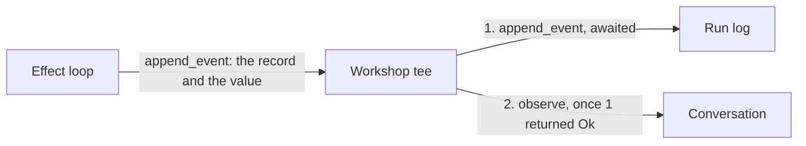

# Let `RunSetup::new` take a service in any form, warn when a `RunReport` is dropped, and hand the recorder each event with its record

Three changes to the run side of the Harness API, as four code commits in `runvil-harness` and three in `runvil-workshop`. Each change stands alone, so striking one leaves the others whole.

This is the second form of this plan. The first form made the three stock services come out of their constructors inside an `Arc`, and handed the recorder each event in a second call. On 2026-11-21 I reviewed that form against the code of the Harness, of Workshop, and of the six programs in `runvil-classroom`, and you took my advice on both points. Two findings changed the plan:

- **The wrappers that Hosts write are around their own types.** Workshop wraps its own recorder and its own broker, and the classroom programs wrap the Gateway broker and brokers and timers that they wrote themselves. Constructors on three stock types leave all of those wrappers in place. So the wrapping is removed at the one place where every service arrives, `RunSetup::new`.
- **A second call hands over the event too late.** A recorder that gets the value after the record is stored can use the two together only by parsing the JSON, and it can neither wait nor refuse at that point. One call hands over both.

## How the work is delivered

You asked for this order, and every step below follows it.

- **The plan goes into the repo first.** The first commit of the work is the approved plan alone, copied to `runvil-harness/plan/`, as each earlier plan of the repo began.
- **Each commit names this plan in the last line of its message,** as the commits of the earlier plans do. The plan line has a section of its own below.
- **Each testable step is one commit on `master`.** A commit is made only after the whole verification list of its repo has passed on it. The Harness has four such commits and Workshop has three. The plan copy and the record are commits of text alone.
- **Each repo is pushed to `origin`,** the fork under `vinniefalco`, and a pull request is opened from `vinniefalco:master` to `cppalliance`. GitHub Actions runs on each pull request.
- **Nothing reaches `upstream` before GitHub Actions is green on both pull requests.** Green means the job `ci-green` of the workflow CI on both, and the five builds of Workshop's workflow Bundle, each on the last commit of its pull request.
- **The merges go in order: the Harness first, then Workshop.** Workshop pins a Harness commit, so upstream `master` of the Harness has to hold that commit before upstream `master` of Workshop names it.

The steps:

1. Harness commit 0, the first step. I check both trees and both upstream heads against Where this starts. I give the commit rule and the message check the plan line. Then I copy the approved plan alone to `runvil-harness/plan/` as `<date>-<n>-run-services-and-event-values.plan.md`, with the date of that day and the next free number, and commit it. Its subject has the form of the earlier ones, "Add the plan for ..".
2. Harness commits 1 to 4. For each one I make the change, run `verify.ps1 -Tag h<n>`, and see `exit=0` on every line and the expected test count. Then I write the message from the staged diff, end it with the plan line, check it with `check-message.ps1`, and commit.
3. The Workshop dry run under a temporary `[patch]` section. It builds and tests Workshop against the local Harness before anything is pushed.
4. Harness commit 5: the record, in the repo copy of the plan. Its subject has the form "Record what the build found for ..".
5. Push the Harness to `origin` and open its pull request.
6. Workshop commits 1 to 3, each verified with `verify-workshop.ps1 -Tag w<n>` before it is committed, and each with the plan line. Then push Workshop to `origin` and open its pull request.
7. Wait for GitHub Actions on both pull requests. A failed check, or a review finding that is right, gets a new commit on the fork, verified the same way, and the wait starts again.
8. Merge the Harness with a fast-forward push of `master` to `upstream`, and confirm it. Then merge Workshop the same way, and confirm it.
9. Confirm that each fork equals its upstream, and report the run of GitHub Actions that each merge starts on upstream `master`.
10. Correct the API report.

What each step needs:

- **Harness commit 0** comes first because every later commit names the plan copy, so the repo has to hold that file before them.
- **Harness commit 1** is the first build of the new trait on the real crates. It leaves every call site as it is on purpose: the whole suite then passes with today's spelling, which is the test that no existing call breaks.
- **Harness commit 2** needs commit 1. **Commit 3** is independent of the others. **Commit 4** comes after commit 2, so that its new tests hand their recorders over in the new form.
- **The dry run** needs Harness commits 1 to 4 in the local checkout. I make the Workshop edits while commit 4 is being verified, and I draft each commit message from the staged diff while its verification runs.
- **Workshop commit 1** needs an open Harness pull request, so that GitHub can serve the pinned commit.
- **The merges** need green checks on the last commit of both pull requests, and two upstream branches that have stayed where they were.

Publishing, in order, has the commands.

## The plan line

Each commit of this work names the plan in the last line of its message. You asked for this on 2026-11-21, and it is how the two repos mark the commits of a plan.

- **What the history shows.** 1,063 of the Harness's 1,387 commits end with a `Plan:` line. `4afed45f` of 2026-11-18 ends with `Plan: /plan/2026-11-16-1-tool-file-effects.plan.md`, a path from the root of the repo. A Workshop commit for a plan that the Harness holds names that repo first, as `799af3b3` does: `Plan: runvil-harness/plan/2026-11-16-1-tool-file-effects.plan.md`.
- **The gap.** The 32 Harness commits of the four plans since 2026-11-20 lack the line, and so does each of the 12 Workshop commits since `799af3b3`. The messages of those four plans were written by [.cursor/rules/commit.mdc](.cursor/rules/commit.mdc) as it stands: its shape of a message ends at the bullets, and it bans every mention of a plan. Those commits are merged, so they stay as they are.
- **The line for this plan.** In the Harness it is `Plan: /plan/<file>`, and in Workshop it is `Plan: runvil-harness/plan/<file>`. `<file>` is the name that commit 0 gives the copy. One blank line stands before the plan line, and it is the last line of the message.
- **Every commit has it:** the plan copy, each code commit, the record, and each fix after a review.
- **The rule and the check gain the line before the first message is written,** so that the rule, the check, and this plan agree:
  - `commit.mdc`: the shape of a message gains `{plan-line}` as its last part, present only while a plan is being run. Its text is exactly `Plan: <path>`. The path comes from the request, as the issue number of the close line does, because the diff cannot show it. The ban on naming the plan then covers the subject, the paragraph, and the bullets, and the self-check asks for the line.
  - `check-message.ps1`: with a new parameter `-Plan <path>`, it fails unless the last non-empty line of the message is exactly `Plan: <path>`.

## What a Host writes, before and after

### 1. The three services

Today, in [runvil-harness/crates/runvil/examples/run-prompt.rs](runvil-harness/crates/runvil/examples/run-prompt.rs), lines 42 to 47:

```rust
let setup = RunSetup::new(
    Arc::new(MemoryRecorder::new()),
    Arc::new(OfflineBroker),
    Arc::new(TokioTimer),
)
.args(r#"{"text":"desk"}"#);
```

After, each line below compiles, and so does the code of today:

```rust
// The service itself. The three stock types stay plain values.
let setup = RunSetup::new(MemoryRecorder::new(), OfflineBroker, TokioTimer)
    .args(r#"{"text":"desk"}"#);

// A Host on the Gateway, with a recorder of its own.
let setup = RunSetup::new(my_recorder, GatewayBroker::new(endpoint, key), TokioTimer);

// A handle that the Host keeps, in either spelling. It stays the one `Arc`.
let recorder = Arc::new(MemoryRecorder::new());
let setup = RunSetup::new(recorder.clone(), OfflineBroker, TokioTimer);
let setup = RunSetup::new(Arc::clone(&recorder), OfflineBroker, TokioTimer);

// An `Arc<dyn ..>`, as a function that picks a broker at run time returns one.
let broker: Arc<dyn InferenceBroker> = pick_broker();
let setup = RunSetup::new(MemoryRecorder::new(), broker, TokioTimer);
```

What makes it work:

```rust
/// Anything that can become a shared service: the service itself,
/// an `Arc` of it, or an `Arc<dyn ..>`.
pub trait IntoShared<D: ?Sized> {
    fn into_shared(self) -> Arc<D>;
}

// Three impls for each of `RunRecorder`, `InferenceBroker`, and `Timer`:
impl<T: RunRecorder + 'static> IntoShared<dyn RunRecorder> for T {
    fn into_shared(self) -> Arc<dyn RunRecorder> { Arc::new(self) }
}
impl<T: RunRecorder + 'static> IntoShared<dyn RunRecorder> for Arc<T> {
    fn into_shared(self) -> Arc<dyn RunRecorder> { self }
}
impl IntoShared<dyn RunRecorder> for Arc<dyn RunRecorder> {
    fn into_shared(self) -> Arc<dyn RunRecorder> { self }
}

impl RunSetup {
    pub fn new(
        recorder: impl IntoShared<dyn RunRecorder>,
        broker: impl IntoShared<dyn InferenceBroker>,
        timer: impl IntoShared<dyn Timer>,
    ) -> RunSetup;
}
```

### 2. The report

Today this line compiles without a warning. The `?` covers the recorder alone, so a run that failed passes as a success:

```rust
Harness::new(host, prompt, setup).run().await?;
```

After, `RunReport` is `#[must_use]`, the compiler warns that the report is unused, and CI denies warnings. The example's form, `.run().await?.result?`, stays as it is.

### 3. Events

Today the Harness holds each event as a value, turns it into JSON for the record, and hands the recorder the JSON alone. Workshop's recorder then copies that JSON and parses the event back out of it, with an error branch for a parse that fails only if the two crates disagree about the type ([runvil-workshop/crates/workshop/agents/src/tee.rs](runvil-workshop/crates/workshop/agents/src/tee.rs), lines 43 to 62). After, the Harness calls one method for an event, with the record and the value:

```rust
pub trait RunRecorder: Send + Sync {
    // begin_run, append, and end_run stay as they are.

    /// Adds the record of one event to an open run, with the event itself.
    /// The Harness calls it in place of `append` for an event. The default
    /// stores the record through `append`.
    fn append_event<'a>(
        &'a self,
        run: RunId,
        record: Record,
        _event: &'a Event,
    ) -> BoxFuture<'a, Result<(), Error>> {
        self.append(run, record)
    }
}
```

Workshop's tee after:

```rust
fn append(&self, run: RunId, record: Record) -> BoxFuture<'_, Result<(), Error>> {
    self.inner.append(run, record)
}

fn append_event<'a>(
    &'a self,
    run: RunId,
    record: Record,
    event: &'a Event,
) -> BoxFuture<'a, Result<(), Error>> {
    Box::pin(async move {
        self.inner.append_event(run, record, event).await?;
        self.conversation.observe(event);
        Ok(())
    })
}
```



## For the agent that runs this plan

In this file, "I" is the agent that runs the plan, and "you" is the owner of the repos.

- **Read first:** the section "For the agent that runs this plan" of [runvil-harness/plan/2026-11-21-1-host-builder-and-run-timer.plan.md](runvil-harness/plan/2026-11-21-1-host-builder-and-run-timer.plan.md). Its short names, its three scripts in `cabinet/_scratch/remove-ui-build/`, its notes on this machine, and its list of checks apply here as written. Then [runvil-harness/AGENTS.md](runvil-harness/AGENTS.md), [runvil-workshop/AGENTS.md](runvil-workshop/AGENTS.md), and [.cursor/rules/commit.mdc](.cursor/rules/commit.mdc).
- **The form of the record:** the part of that same file from the heading `# What the build found`.
- **The notes of this run:** `cabinet/_scratch/run-api-cleanup/notes.md`, with each commit message and the two patch files of the dry run beside it.
- **The conversation behind this plan:** the chat [Host builder plan](211698d2-851d-4214-ac0c-96a33d2e0a6a).
- **The owner reads Rust as a C++ expert who is new to Rust.** Each report says what a Rust form does in plain words, and names its C++ counterpart where one exists.
- **Rules of this work:**
  - This file stays as it is during the run.
  - The plan copy is the first commit, and every commit message ends with the plan line.
  - Each code commit passes the whole verification list of its repo first, and is one commit on `master`.
  - Workshop's pin names a Harness commit that the Harness pull request holds.
  - Nothing reaches `upstream` before GitHub Actions is green on both pull requests, and the Harness merges first.
  - A question to you is a choice between concrete options, and every report gives the facts before the finding.

## What was checked before this plan was written

On 2026-11-21 I type-checked stand-in programs with rustc 1.99.1, read from standard input with the output discarded. The real crates are unbuilt, so the first build of commit 1 is the proof.

- **The conversion trait compiles over three traits of its own crate.** One trait with nine impls accepted each of these as an argument: the service itself, today's `Arc::new(..)` spelling, a kept handle as `recorder.clone()` and as `Arc::clone(&recorder)`, an `Arc<dyn ..>`, one object in all three places, and a value passed through a function of the Host's own that has the same bound.
- **A kept handle stays the one `Arc`.** The impl for `Arc<T>` returns the `Arc` it was given. The stand-in type-checked the two assertions of commit 1's second test, the holder count and the pointer comparison, and they run for the first time in that test.
- **`append_event` compiles in four shapes.** The default body that calls `append`, an override that stores and then shows, one that shows and then stores, and one that writes a field of the event beside the record. The future of the call through an `Arc<dyn RunRecorder>` is `Send`.
- **The compiler's words for three mistakes.** A service in the wrong place is refused with the message of the attribute on the trait. `Arc::clone(&recorder)` at today's parameter is refused with "expected `&Arc<dyn RunRecorder>`, found `&Arc<MemoryRecorder>`". A report dropped behind a `?` gets "unused `RunReport` that must be used", with the note of the attribute.
- **The same pair of impls is refused for a trait of another crate,** with "upstream crates may add a new impl of trait ... for type `Arc<_>` in future versions". `PromptFinder` is the Engine's, which is why the finder is under Not in this plan.

## Where this starts

Read from the checkouts and from GitHub on 2026-11-21 at about 13:40 PST.

- **`runvil-harness`:** local `master`, the fork, and `cppalliance` are all `665ff7d8`. Its tests: 3,999.
- **`runvil-workshop`:** all three are `73e4fccd`, which pins the Harness at `6efe4ad7`. Its two groups of tests: 706 and 354.
- **If an upstream head has moved by the day you say go,** I fast-forward that checkout and its fork first and run the tests once for the base count. The two commit ids under Publishing, in order, then become the new heads.
- **Open pull requests:** Harness [#60](https://github.com/cppalliance/runvil-harness/pull/60), [#56](https://github.com/cppalliance/runvil-harness/pull/56), [#27](https://github.com/cppalliance/runvil-harness/pull/27), [#14](https://github.com/cppalliance/runvil-harness/pull/14), and Workshop [#32](https://github.com/cppalliance/runvil-workshop/pull/32), [#28](https://github.com/cppalliance/runvil-workshop/pull/28), [#22](https://github.com/cppalliance/runvil-workshop/pull/22). Each call of `RunSetup::new` that they hold keeps compiling, because commit 1 accepts today's spelling, and each recorder that they hold keeps working, because `append_event` has a default body.
- **The guide and the classroom stay as they are.** A search of `runvil-docs` for the three stock types found zero lines, and its one line about `Harness::run` stays true. Each program of `runvil-classroom` pins an older Harness commit.

## Harness commit 1: `RunSetup::new` takes each service in any of three forms

### Why

A run shares each of its three services. The loop takes a handle to each, in [runvil-harness/crates/harness-internal/runner/src/effect_loop.rs](runvil-harness/crates/harness-internal/runner/src/effect_loop.rs) at lines 195 to 198, and each model round and each sleep takes one more, at lines 581 and 621. So each service ends up inside an `Arc`, and today the caller puts it there: `RunSetup::new(` is written 23 times in the Harness and 4 times in Workshop, and each of the 23 wraps two or three of its arguments.

The wrappers that Hosts write are around their own types:

- **Workshop's `setup_for`,** in [runvil-workshop/crates/workshop/server/src/agents.rs](runvil-workshop/crates/workshop/server/src/agents.rs) at lines 468 to 479, has three: around its own `AgentRecorder`, around its own `RunBroker`, and around `TokioTimer`.
- **The classroom programs** wrap a `GatewayBroker` (`robles/checkprompt` line 225, `kirill/runner` line 131), a broker of their own (`parsons/verify-briefer.rs` line 419), and, in five of the six, a timer of their own.

So the change is made where every service arrives. `RunSetup::new` takes each service as the service itself, as an `Arc` of it, or as an `Arc<dyn ..>`, and puts a bare service into an `Arc` itself. A handle that a Host keeps passes through as the same `Arc`, and the three service traits stay as they are.

### Code

- [runvil-harness/crates/harness-internal/runner/src/setup.rs](runvil-harness/crates/harness-internal/runner/src/setup.rs): the trait `IntoShared<D: ?Sized>` with the one method `fn into_shared(self) -> Arc<D>`, beside `RunSetup`. Nine impls are written out by hand, three for each of `RunRecorder`, `InferenceBroker`, and `Timer`:
  - for every `T` that implements the service trait: `Arc::new(self)`
  - for `Arc<T>`: the same `Arc`, converted to `Arc<dyn ..>`
  - for `Arc<dyn ..>`: the same `Arc`
- `RunSetup::new` takes `impl IntoShared<dyn RunRecorder>`, `impl IntoShared<dyn InferenceBroker>`, and `impl IntoShared<dyn Timer>`, and calls `into_shared()` on each. The three public fields stay `Arc<dyn ..>`.
- The trait gets `#[diagnostic::on_unimplemented(..)]`, so a wrong argument is refused in plain words: the message names the type, and the note names the three forms. I build one wrong call by hand and put the compiler's text into the notes.
- The runner's `lib.rs` exports `IntoShared` beside `RunSetup`, and [runvil-harness/crates/runvil/src/lib.rs](runvil-harness/crates/runvil/src/lib.rs) re-exports it as `runvil::harness::IntoShared`.
- `MemoryRecorder`, `OfflineBroker`, `TokioTimer`, and `GatewayBroker` stay exactly as they are.

### Call sites

Every call site stays as it is in this commit. Each of the 23 calls passes an `Arc` of a concrete type or an `Arc<dyn ..>`, and the trait takes both. So this commit's verification is the test that today's spelling keeps compiling and that every run behaves as before. Commit 2 then shortens the calls.

### Tests

Two unit tests at the bottom of `setup.rs`, with three small services of their own:

- `a_setup_takes_a_service_as_itself_inside_an_arc_and_as_an_erased_arc`: it builds a setup from each of the three forms. The timer is a clock pinned at one instant, and `setup.timer.now()` reads that instant in each form, so a clock that arrives inside an `Arc` still reads its own time.
- `a_handle_handed_to_a_setup_stays_the_one_arc`: after `RunSetup::new(recorder.clone(), ..)`, `Arc::strong_count(&recorder)` is 2, and the pointer in `setup.recorder` equals the pointer of the handle.

Expected count: 4,001.

### Pages and docs

- [runvil-harness/decisions/harness-and-host.md](runvil-harness/decisions/harness-and-host.md), two entries:
  - "`RunSetup::new` takes the recorder, the broker, and the timer, and every other field has a default" gains the three forms and the reason. A run shares each service, so the setup holds each inside an `Arc`. `RunSetup::new` takes the service itself and makes that `Arc`, or takes an `Arc` that the Host already holds and keeps it as it is, so a Host that reads its recorder after the run hands over a clone of its own handle.
  - "`TokioTimer` is the stock timer of a Host that runs on tokio": "passes `Arc::new(TokioTimer)`" becomes "passes `TokioTimer`".
- Rustdoc: the trait, `RunSetup::new`, and the facade's `harness` module doc.
- **One wrong line that I found while reading.** The crate doc of the Gateway client, [runvil-harness/crates/harness-gateway-client/src/lib.rs](runvil-harness/crates/harness-gateway-client/src/lib.rs) lines 5 to 6, says that a Host passes `GatewayBroker` to `Harness::new`. A Host passes it to `RunSetup::new`. This commit corrects it. That file has `## Invariants`, so the wording check reads it.

### Listing

The diff of `crates/runvil/public-api.txt` must be one changed line, that of `RunSetup::new`, and the new lines of `IntoShared`: the trait, its method, and its nine impls. The Engine's listing stays as it is.

## Harness commit 2: the calls of `RunSetup::new` drop their wrappers

This commit changes how the calls are written and nothing that a run does.

- **The rule:** at a call of `RunSetup::new`, an argument written as `Arc::new(x)` becomes `x`. Counted on 2026-11-21, that is 52 places in the 23 calls of the Harness.
- **The example is one of the 23.** It then reads as the first line under What a Host writes, it loses `use std::sync::Arc;`, and the comment of its step 3 says that the Host passes each service itself.
- **A handle that a test keeps stays as it is.** The other 66 `Arc::new(MemoryRecorder::new())` of the Harness are each bound to a name or handed to a helper, and the test reads the run back through them.
- **A field that is assigned directly keeps its `Arc::new`,** because the fields stay `Arc<dyn ..>`. Struct update syntax does that in 4 places.
- **The tool performer that `drive_run` takes keeps its `Arc::new`.** It is an argument of `drive_run` itself and stands outside the setup, which this plan leaves alone.
- **Each file whose last `Arc` goes loses its import.** The compiler names them.
- **Tests and listing:** the tests are the ones that exist, and the listing stays as it is. Expected count: 4,001.

## Harness commit 3: a `RunReport` that is dropped unread is a warning

- **Code:** `#[must_use = "..."]` on `RunReport`, in [runvil-harness/crates/harness-internal/runner/src/harness.rs](runvil-harness/crates/harness-internal/runner/src/harness.rs) at line 69. The message says that the report tells how the run ended, and that a failed run is an `Err` in `result`.
- **The one discard:** [runvil-harness/crates/harness-internal/runner/tests/it/harness-errors.rs](runvil-harness/crates/harness-internal/runner/tests/it/harness-errors.rs), lines 193 to 196, runs a baseline run to count the recorder's calls and drops its report. I build once before I touch it: clippy must refuse that statement with `unused_must_use`, and that refusal is the test that the attribute fires. Then the statement binds the report and asserts that its result is `Ok("1")`, the text that its prompt returns.
- **Every other call binds its report.** I read each of the 64 calls of `Harness::run` in the Harness's tests and example, each call of the four test helpers that return a `RunReport`, and Workshop's one call, which hands the result to `take_report`.
- **Page:** the entry "`Harness::run` returns a `RunReport` for every run, and its one error is `RecorderFailed`" gains one sentence: a report that a Host drops unread is a compiler warning, because a failed run is an `Err` inside the report.
- **Listing:** stays as it is, because it records attributes of no item. Expected count: 4,001.

## Harness commit 4: the recorder is handed each event with its record

### Why

The page says that events exist to show a run's progress, and a Host that shows progress wants the value. The Harness has the value and hands over JSON alone, so Workshop parses each event back. One method that takes the record and the value ends that. The recorder then has both in one place, so it sets the order of storing and showing itself, it can use a field of the event while it stores the record, and it can wait or refuse as it does in `append`.

### Code

- [runvil-harness/crates/harness-internal/runner/src/recorder.rs](runvil-harness/crates/harness-internal/runner/src/recorder.rs): `RunRecorder` gains `append_event`, as shown under What a Host writes. Its doc says four things. The Harness calls it in place of `append` for an event. It is handed the event's record and the event itself. Its default stores the record through `append`, so a recorder that only stores stays as it is. A recorder that wraps another passes the call on to the inner recorder's `append_event`.
- `commit_event` in `effect_loop.rs`, lines 654 to 659: it calls `self.recorder.append_event(self.run_id, record, event)` and maps a refusal as `append` does. `commit_event` is the one place that appends an event.
- `MemoryRecorder` and the seven test recorders take the default. `FailingRecorder` counts its calls in `append`, which the default reaches, so its counts stay.

### Tests

Two new ones in [runvil-harness/crates/harness-internal/runner/tests/it/effect_loop-recorder.rs](runvil-harness/crates/harness-internal/runner/tests/it/effect_loop-recorder.rs):

- `the_loop_hands_each_event_to_append_event_with_its_record`: a test recorder overrides `append_event` and logs what it is handed. Each event record arrives there with the value that serializes to the record's payload, at least one arrives, and each effect and answer record arrives through `append`.
- `a_refused_append_event_ends_the_drive_as_a_recorder_failure`: the override refuses, the drive ends with `RecorderFailed` and the run's `Run` fact, and the recorder gets no later call.

The default path is covered by every test that reads event records out of a `MemoryRecorder`. Expected count: 4,003.

### Pages and docs

- The entry "The Host supplies the `RunRecorder` and receives a run's events through it". Its sentence "`append` is the only call in which the Harness passes an event to the Host" names `append_event`: it is the one call in which the Harness passes an event to the Host, with the event's record and the event itself, and its default stores the record through `append`. The reason: the record is JSON because a store keeps text and a replay compares it, and the value is for a Host that shows a run's progress or stores a part of the event in a place of its own.
- Rustdoc: the trait, the module doc of `recorder.rs`, and in [runvil-harness/crates/runvil/src/lib.rs](runvil-harness/crates/runvil/src/lib.rs) the docs of the modules `harness` and `event`.

### Listing

One new line, `runvil::harness::RunRecorder::append_event`.

## Workshop: three commits

Workshop builds against the new Harness as it is today, because both Harness changes accept the code of today. So the pin is a testable step by itself, and each use of a new form is one more.

### Workshop commit 1: the pin

- [runvil-workshop/Cargo.toml](runvil-workshop/Cargo.toml), lines 28 to 30: the three `rev` values become the Harness head that the Harness pull request holds. Then `cargo fetch`. `Cargo.lock` must change its 14 source lines for `runvil-harness` and stay as it is everywhere else.
- Workshop's code stays as it is in this commit. Its verification is the test that Workshop as written runs on the new Harness.
- `verify-workshop.ps1 -Tag w1`. Expected counts: 706 and 354.

### Workshop commit 2: the services

- `Conversation::recorder`, in [runvil-workshop/crates/workshop/agents/src/conversation-run.rs](runvil-workshop/crates/workshop/agents/src/conversation-run.rs) at lines 25 to 27, takes `inner: impl IntoShared<dyn RunRecorder>` where it takes `Arc<dyn RunRecorder>`. Its four callers each pass a form that the trait takes.
- `setup_for`, in [runvil-workshop/crates/workshop/server/src/agents.rs](runvil-workshop/crates/workshop/server/src/agents.rs) at lines 468 to 479, loses its three `Arc::new` and then reads:

```rust
fn setup_for(&self, conversation: &Conversation) -> RunSetup {
    let recorder = conversation.recorder(self.inner.recorder.for_agent(conversation.agent()));
    let broker = RunBroker::new(self.inner.broker.clone(), conversation.clone());
    RunSetup::new(recorder, broker, TokioTimer)
        .vfs(language_guide::run_vfs())
        .has_user(true)
}
```

- The tests: the 7 wrapped arguments of the calls in `server/src/agents/tests.rs`, `server/src/agents/bindings-tests.rs`, and `agents/tests/it/support.rs` lose their `Arc::new`. With the one in `setup_for`, those are Workshop's 8.
- `verify-workshop.ps1 -Tag w2`. Expected counts: 706 and 354.

### Workshop commit 3: the tee

- [runvil-workshop/crates/workshop/agents/src/tee.rs](runvil-workshop/crates/workshop/agents/src/tee.rs) as shown under What a Host writes: `append` passes each record on, and `append_event` stores through the inner recorder's `append_event` and then calls `observe`. The copy of the payload, the parse, and its error branch go. The module doc says that the tee is handed each event with its record.
- `tee-tests.rs`: the five tests stay five and keep their assertions. The three that feed events call `tee.append_event(run, record, &event)`. The inner test recorder `Watching` overrides `append` alone, so the default reaches it, and the test of the order still shows that the transcript was empty while the inner recorder took the record.
- `verify-workshop.ps1 -Tag w3`. Expected counts: 706 and 354.

### The dry run, before the Harness is pushed

1. This temporary section goes at the end of Workshop's root `Cargo.toml`. It makes Workshop build against the local Harness checkout, and it stays out of every commit:

```toml
[patch."https://github.com/cppalliance/runvil-harness"]
runvil = { path = "../runvil-harness/crates/runvil" }
harness-gateway-client = { path = "../runvil-harness/crates/harness-gateway-client" }
plugin-mcp = { path = "../runvil-harness/crates/plugin-mcp" }
```

2. With Workshop's code as it is: clippy with warnings denied and nextest for `-p workshop-agents -p workshop-server`, without `--locked`, because the patch changes the lock file. This is the early form of commit 1's test.
3. Make the edits of commits 2 and 3, and run the same two commands again.
4. Save the edits as two patch files beside the notes, one for commit 2 and one for commit 3, with `git diff --output=<file> -- <paths>`. That option makes `git` write the file itself, so the patch stays out of PowerShell's redirection, which can change its encoding.
5. `git restore .` in Workshop, so that the tree is clean again.

### The three real commits, after the Harness pull request is open

- Commit 1: set the pin, `cargo fetch`, verify, commit.
- Commit 2: `git apply` the first patch, verify, commit.
- Commit 3: `git apply` the second patch, verify, commit.
- Then `git push origin master`, and the pull request.

## The record

Harness commit 5 adds "What the build found" to the repo copy of the plan and sets the todo statuses: one heading for each commit with its id, and under it each point that differs from this plan or adds to it. It covers the four Harness code commits and the Workshop dry run. What happens after it, the pull request numbers, the results of GitHub Actions, and the merges, I report in chat. If a review leads to one more commit, a section "After the pull requests opened" is added with it.

## Publishing, in order

1. **Before the Harness is pushed.** `cargo doc -p runvil --no-deps` with `RUSTDOCFLAGS="-D warnings"`, and `cargo deny check`. GitHub Actions runs both beside the verification list, so they run locally first.
2. **The Harness pull request.** `git push origin master`, which runs the pre-push hook. Then `gh pr create --repo cppalliance/runvil-harness --base master --head vinniefalco:master`. Its body has the sections of [#61](https://github.com/cppalliance/runvil-harness/pull/61).
3. **The Workshop pull request.** After Workshop's three commits, `git push origin master`, then `gh pr create --repo cppalliance/runvil-workshop --base master --head vinniefalco:master`. Its body has the sections of [#33](https://github.com/cppalliance/runvil-workshop/pull/33), names the Harness pull request, and says in bold that it merges second.
4. **The wait for GitHub Actions.** `gh pr checks <number> --repo cppalliance/<repo>` shows the checks of a pull request.
   - **The Harness:** the workflow CI has ten jobs and an eleventh, `ci-green`, which succeeds only when all ten did.
   - **Workshop:** the workflow CI has nine jobs and `ci-green`. The workflow Bundle also runs, because the pin changes `Cargo.toml` and `Cargo.lock`, and it builds five bundles. Its file says that the slowest build so far took about 20 minutes.
   - **While they run,** I read the automatic reviews of CodeRabbit and Copilot. A finding that is right gets a fix as a new commit on the fork, verified as every commit is and ending with the plan line.
   - **The merges wait for the checks of the last commit of each pull request,** so a fix starts the wait again.
5. **Merge the Harness.** `git fetch upstream`, and confirm that `upstream/master` is still `665ff7d8`, the commit this work started from. Then `git push upstream master`, and confirm the new head with `gh api repos/cppalliance/runvil-harness/commits/master --jq '.sha'`.
6. **Merge Workshop.** The same four moves in Workshop, with `73e4fccd` as the commit to confirm before the push. This comes only after step 5 is confirmed.
7. **After both.** Confirm that each fork equals its upstream. The workflow CI also runs on a push to `master`, so each merge starts one more run on upstream, and I report both.

Your approval of this plan is the go-ahead for both merges. When step 4 is done, steps 5 to 7 follow directly. Each merge is a fast-forward push, so upstream `master` ends at the exact commit that its pull request tested.

## The API report

[cabinet/_output/host-builder-api-review.md](cabinet/_output/host-builder-api-review.md) recommends a form that you turned down, so a later reader would propose it again. I edit it in place after both merges. Your approval of this plan answers the overwrite question for that file.

- **Candidate A and the summary's advice for it.** The run side is decided: `RunSetup::new` takes each service through a conversion trait, which the report lists as A2 and sets aside in two sentences. A1, the forwarding impl, is turned down, because it puts a kept handle inside a second `Arc` and adds an impl with a default-method trap to each trait. A3, constructors that return an `Arc`, was approved first and replaced the same day, because it helps three stock types and closes their use as plain values.
- **Limits 7.1 and 7.2.** 7.1 is closed by this plan. 7.2 stays, with its reason: the finder's conversion trait has to live in the Engine beside `PromptFinder`, because the compiler refuses the pair of impls in the runner.
- **Section 9.** The owner's decisions of 2026-11-21 join the list, in the order they were made.
- **Candidates B and D.** Each gains the fact under Not in this plan, and its recommendation becomes "when a caller outside tests needs it".
- The last line gets the new date and time.

## When to stop or change course

- **Upstream `master` moved in either repo while this work is open.** I stop and tell you. Before the fork is pushed, the commits can move onto the new head, and each one is then verified again. After the fork is pushed, a move rewrites commits that the fork already holds.
- **The compiler refuses the nine impls as overlapping, or refuses a call of `RunSetup::new` that compiles today.** The stand-in says that neither happens, so I stop and tell you before I change the approach.
- **The `auto` line of a changed type differs,** or a listing diff or the `Cargo.lock` diff holds a line that this plan did not name. I find the reason before I go on, and the record says what it was.
- **A check of GitHub Actions fails on a pull request.** I fix it with a new commit on the fork. If that commit changes Harness code, Workshop gets one more commit that moves its pin to it.
- **GitHub Actions stays red for a reason outside this work,** such as a runner that is down. I tell you what failed and wait. Nothing merges on a red check.

## Choices I settled

- **`commit.mdc` and `check-message.ps1` gain the plan line.** Confidence: medium - the rule as it stands is why the commits of four plans lost the line, and a check keeps the next commit from losing it. It is your rule file, so if you strike this, the line stays as an instruction of this plan alone.
- **One generic trait, `IntoShared<D>`, in place of three named ones.** Confidence: medium - it is one item to learn, and each parameter still names its service, as in `impl IntoShared<dyn RunRecorder>`.
- **The trait is in `setup.rs` beside `RunSetup`, and its nine impls are written out by hand.** Confidence: medium - it is the interface of `RunSetup::new`, and nine short impls read more plainly than a macro to an owner who is new to Rust.
- **The trait is open, so a Host may implement it for a handle type of its own.** Confidence: medium - the standard library's `IntoIterator` is open in the same way, and its use by a Host is still to come.
- **The trait has `#[diagnostic::on_unimplemented]`.** Confidence: medium - the stand-in's message for a broker in the timer's place named the type and the three forms, and the exact words are settled at the first build.
- **The new signature and the shorter calls are two commits.** Confidence: medium - the first then tests that today's spelling still works, and the second is mechanical.
- **The tidy rule covers the 27 calls of `RunSetup::new` and stops there.** Confidence: medium - it is one rule that the compiler checks, and a kept handle is the Host's own choice.
- **The stock types and `GatewayBroker` stay exactly as they are.** Confidence: high - the code uses each as a plain value, and the trait takes a plain value.
- **Workshop has three commits: the pin, the services, the tee.** Confidence: medium - each passes Workshop's whole list by itself, and the pin alone tests that Workshop as written runs on the new Harness.
- **`Conversation::recorder` takes `impl IntoShared<dyn RunRecorder>`.** Confidence: medium - it removes the last wrapper in `setup_for`, and each of its four callers passes a form that the trait takes.
- **`append_event` has a default body that calls `append`.** Its cost: a recorder that wraps another and overrides `append` alone sends the record on through `append`. The store stays complete, and an inner recorder that wants the value misses it without an error. The form without that trap is a third argument on `append`, which each of the 11 recorders of the two repos and every direct call would then take. Confidence: medium - the one reader today, Workshop's tee, is the outermost recorder, and `Timer::now` and `ToolPerformer::render` have default bodies already.
- **`append_event` borrows the event for as long as its future lives.** Confidence: high - the tee passes the event on and reads it afterwards, and an owned event would need a copy for that.
- **The tests of commit 1 are unit tests in `setup.rs`.** Confidence: medium - `AGENTS.md` puts tests at the bottom of the file under test when that is practical.
- **A Host that reads its run back keeps a handle and passes a copy,** as in `RunSetup::new(recorder.clone(), ..)`. Confidence: high - it is the C++ idiom with one visible copy, and it works for every service. Five other forms were looked at on 2026-11-21 and are under Not in this plan.

## Not in this plan

- **The finder of `Host::builder`.** It keeps `Arc<dyn PromptFinder>`, and the two one-prompt finders keep returning an `Arc`, as you asked. The same convenience for the finder needs a conversion trait in the Engine, beside `PromptFinder`.
- **Constructors that return an `Arc` for the stock types.** That was the first form of this plan. The trait takes a plain value, so the stock types stay as they are.
- **Other ways to read a run back.** A reference to a handle, as in `RunSetup::new(&recorder, ..)`, is two more impls for each service, and it hides the copy of the pointer. A `MemoryRecorder` that shares its storage when copied, and a constructor that returns the setup with a handle, each help the recorder alone. A checked cast on the report finds a wrong type at run time. A report that hands the recorder back with its type puts a type parameter on `RunSetup`, `Harness`, and `RunReport`. The first is the one to add if `.clone()` at the call turns out to bother.
- **A closure on the setup that watches events,** as in `.on_event(|run, event| ..)`. It is the most compact way to watch a run. Workshop needs the order "store, then show", which its tee keeps, and the classroom programs read the records after the run. `append_event` leaves room for it.
- **A third argument on `append`.** See Choices I settled.
- **`plugin_steps()`, `plugin_failures()`, and `unavailable_packs()` on `Host`.** Every call of `plugin_reports()` in both repos is in a test, and Workshop's production code reads `host.packs()` alone. Workshop's warning checks three shipped Packs that all come from Plugins of the C contract, and only a Rust `install` inserts a Pack as unavailable, so a shipped Pack is either there and usable or missing. All three are additions, so they can come later without a break.
- **`ChatRequest`,** one argument for `InferenceBroker::chat`. It comes with the first new field of a round.
- **Starting a run by the name of a prompt.** A parse at every launch hides its cost, and Workshop parses on a blocking thread.
- **`TursoRecorder::new` in Workshop.** It is wrapped in `Arc::new` at all 8 places that call it. It is handed to `for_agent`, and what reaches `RunSetup::new` is the `AgentRecorder` that `for_agent` returns, so this plan leaves it.

# What the build found

The plan held in both repos. This record was written after the four Harness code commits and the Workshop dry run, and before anything was pushed. These points differ from the plan above, or add to it.

## Before the first commit

- **Both repos were where this plan said.** Local `master`, the fork, and upstream were `665ff7d8` in the Harness and `73e4fccd` in Workshop, both trees were clean, and the open pull requests were the same seven.
- **The commit rule and the message check gained the plan line first.** `check-message.ps1 -Plan <path>` failed a message with another path when it was tried. It also asks for a blank line before the plan line.
- **The message check now runs every check and then fails,** where it stopped at the first failure.

## Harness commit 0, `742e1349`: the plan

- **The copy is the approved text, with every todo `pending`.** The Cursor plan file showed the first todo as `in_progress` when the copy was taken. So the copy was made from the text that the owner attached, which differs from that file in the one line.
- **`git` reads the plan line as a trailer.** `git log --format="%(trailers:key=Plan,valueonly)"` prints the path for each commit of this work.

## Harness commit 1, `9700b0cb`: `RunSetup::new` takes each service in any of three forms

- **The first build on the real crates was clean.** The nine impls stand side by side, and each of the 23 existing calls of `RunSetup::new` compiled unchanged. The count is 4,001.
- **The listing gained two lines that this plan did not name.** Beside the changed line of `RunSetup::new`, the trait, its method, and the nine impls, it holds one line each for `MemoryRecorder` and `OfflineBroker`, of the form `impl<T> IntoShared<dyn RunRecorder> for MemoryRecorder where T: RunRecorder + 'static`. Rustdoc lists a blanket impl again on the page of each type that it covers, and the listing keeps such a line when the trait is one of the facade's own. These are the first blanket impls of a facade trait that cover named types of the facade. `TokioTimer` is outside the facade, so the listing holds no such line for it.
- **The tests use the stock recorder and broker, and one clock of their own.** This plan said three small services of their own. `MemoryRecorder` and `OfflineBroker` are less code, and they are what a Host passes.
- **The holder count alone cannot show that a handle stays the one `Arc`.** `Arc::strong_count` is 2 whether the setup keeps the handle or puts it into a second `Arc`, because the clone is counted either way. The assertion that fails for a second `Arc` compares the address that the setup holds with the address of the handle. The test keeps both assertions, and each message says what it shows.
- **The second test also hands over an `Arc<dyn RunRecorder>`,** and checks with `Arc::ptr_eq` that the setup holds that same `Arc`.
- **The compiler's words for a wrong argument** come from a call with a timer in the broker's place, built by hand and taken out again. The compiler adds a help line of its own, which names the trait that the type lacks.

  ```text
  error[E0277]: `setup::tests::Pinned` cannot be handed over as a shared `(dyn performers::InferenceBroker + 'static)`
    = note: pass a value that implements the trait of the service, an `Arc` of one, or an `Arc<dyn ..>` of that trait
  ```

- **Docs outside this plan's list:** the module doc of `setup.rs`.
- **Seen and left:** the type doc of `GatewayBroker` says that a Host passes the broker to the Harness. It names no function, so it is true as it stands.

## Harness commit 2, `c5baae01`: the calls of `RunSetup::new` drop their wrappers

- **52 wrappers went, in the 23 calls, as counted,** and 16 files changed. The count stays 4,001, the listings match with no bless, and the example printed `Hello, desk.`.
- **Two files lost their import of `Arc`:** the example and `launch.rs` of the facade suite.
- **The example's setup is one statement.** `cargo fmt` breaks it after `let setup =`.

## Harness commit 3, `bb715154`: a `RunReport` that is dropped unread is a warning

- **The attribute fired at the one statement that this plan named, and at no other place of the workspace.** Built with the test as it was, clippy with warnings denied refused lines 193 to 196 of `harness-errors.rs`:

  ```text
  warning: unused `harness_runner::RunReport` that must be used
    = note: the report says how the run ended: a failed run is an `Err` in `result`
  help: use `let _ = ...` to ignore the resulting value
  ```

- **The doc of `RunReport` gained a paragraph** that says why the compiler warns. This plan named the attribute and the page.
- **The count stays 4,001,** and the listings match with no bless.

## Harness commit 4, `8dce444c`: the recorder is handed each event with its record

- **The listing diff is the one line of `append_event`,** and the count is 4,003.
- **The listing shows the parameter as `_event`.** The default body leaves it unused, and the listing prints the name that the code has. `ToolPerformer::render` names its unused parameters the same way.
- **The run of the two new tests hands `append` four records:** effect, answer, effect, answer. Each event went to `append_event`.
- **The refusal of the second test has the code `Io`.** So the test also shows that the loop turns another code into `RecorderFailed` on this path, as an existing test shows for `append`.
- **Clippy's `large_enum_variant` refused the call log of the tests,** because an `Event` is at least 432 bytes. The log holds the event in a `Box`.
- **One more page sentence changed.** `testing-and-debugging.md` said that the Harness calls `RunRecorder::append` for each event. It names `append_event` now. The module doc of `effect_loop.rs` gained one sentence.
- **Every other recorder is as it was.** `MemoryRecorder` and the seven recorders of the tests take each event through the default, and the recorder that counts its calls counts the same calls as before.

## The Workshop dry run

- **Workshop built against the local Harness checkout at `8dce444c`** through a temporary `[patch]` section. Cargo locked 14 packages to that checkout, so the patch was in use.
- **Workshop as written runs on the new Harness.** With its code as it is, clippy with warnings denied passed for `workshop-agents` and `workshop-server`, and their tests passed: 278 run, with 2 skipped. That is the early form of the test of Workshop commit 1.
- **Each set of edits passed by itself, and both passed together,** with the same 278 tests, the five tests of the tee among them.
- **The edits are two patch files,** one of five files for the services and one of two files for the tee. Each passes `git apply --check` on the clean tree, and `git restore .` left Workshop clean at `73e4fccd`.
- **The edits are as this plan wrote them.** `Conversation::recorder` takes `impl IntoShared<dyn RunRecorder>`, `setup_for` is free of `Arc::new`, seven wrapped arguments of three test files are plain, and the tee overrides `append_event`. `bindings-tests.rs` lost its import of `Arc`, and `tee.rs` its import of `RecordKind`.
- **Two docs go beyond this plan.** The doc of `Conversation::recorder` names the three forms, and the doc of the test recorder `Watching` says that it leaves `append_event` at its default.

## Still to come when this record was written

- The push of the Harness to the fork, and its pull request.
- The three Workshop commits on the real pin, each with Workshop's whole verification list, and Workshop's pull request.
- The two merges, the Harness first, once GitHub Actions is green on both pull requests.
- The correction of the API report.

Each of those is reported in its pull request and in the chat, because a record of them would be one more commit after the merge.
