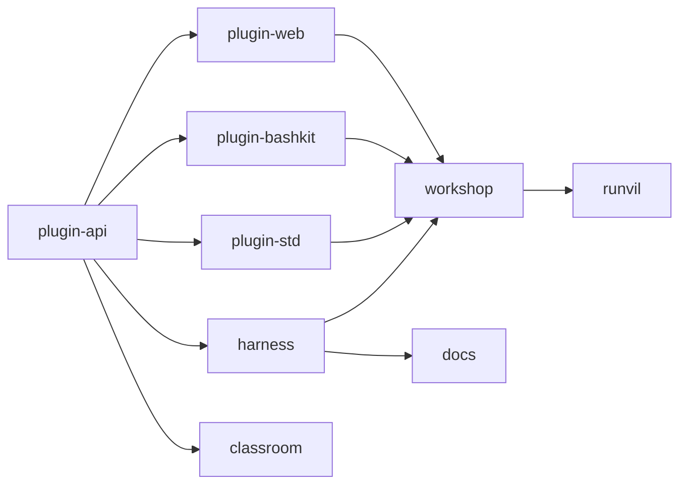

# Pack render verb

This is the part of the plan for contract 0.7 that concerns this repository. The contract, the SDK, and the fake Host live in runvil-plugin-api and merge first; the Plugin repositories, Workshop, runvil, and runvil-docs pin what this repository merges.

## The idea in plain terms

- **Catalog tool.** A tool a Pack declares when a run starts, such as `fs/edit`. Lua can call it by id, a prompt offers it with `tools.offer("fs/edit")` or `tools.offer("fs")`, and its parameters are documented and fixed for the run.
- **Model-facing tool.** A tool that exists only in a render's answer, such as `fs/str_replace` for Anthropic models or `fs/apply_patch` for OpenAI models. Only the model can call it. Lua can't name it.
- **Render.** At a section entry's first `models.loop` round, the Harness asks each offered Pack: "here are the tools the section offered and here is the model, what should the model see?" The answer is frozen for that section entry.
- **The name-locked rule.** A tool name always means one parameter schema. A render may give a catalog tool another wire name and description, but different parameters need a different tool name. So a Plugin's `call` matches on the tool name it receives and keeps no memory of what it rendered.
- **What exists today.** The Engine and Harness already do all of this for Rust Packs (`Effect::Render`, the merge, the run log). The C contract stops at verb 6, so a library Pack always passes its tools through unchanged. Today's merge also lets a render rewrite a catalog tool's parameters.
- **What this plan adds.** The verb, the SDK method, the loader's use of it, and the name-locked check in the Engine's merge.

## The contract change

In runvil-plugin-api/crates/runvil-plugin-sys/src/lib.rs, verb 7 leaves the reserved list (8 stays reserved) and the version becomes 0.7:

```rust
pub const RV_PACK_RENDER: RvVerb = 7;

#[repr(C)]
pub struct RvPackRenderArgs {
    pub size: u32,
    pub reserved: u32,
    pub ctx: *mut c_void,
    pub entry: RvStr,              // the section entry, Lua's sys.id
    pub model: RvStr,              // JSON object of the model's facts
    pub offered: *const RvToolInfo, // the tools the section offered from this Pack, in one set
    pub offered_len: usize,
    pub refuse: unsafe extern "C" fn(ctx: *mut c_void, reason: RvStr) -> RvStatus,
    pub add_tool: unsafe extern "C" fn(ctx: *mut c_void, info: *const RvToolInfo) -> RvStatus,
}
```

- **Call shape.** `call->pack_run` is the instance, as for `RV_TOOL_CALL`. The Plugin calls `add_tool` once for each tool the model should see, in order, and returns `RV_OK`.
- **Statuses.**
  - `RV_ERR_UNSUPPORTED`: the Pack doesn't render, and the offered tools pass through.
  - `refuse`, at most once, with a reason of at most `RV_MAX_LINE` bytes, returns `RV_ERR_REFUSED`: the render failed. It has the same form as `refuse` in `RvPackNewArgs`.
  - Any other status, or a misuse, also fails the render. A failed render fails the round that asked for it.
- **Rules.** It returns promptly, with no I/O and no blocking, like `RV_PACK_NEW`. It may come on any thread, beside tool calls of the same instance, and never beside `RV_PACK_DELETE`. Everything it is lent is valid for the call only.
- **What each offered tool holds.** `name` is the tool's name without the Pack id. `wire_name` is empty when the Host derives it. `parameters` is the Host's own JSON text of the schema, which can differ in spacing and key order from the text the Plugin gave `RV_PACK_NEW`. `flags` are the catalog's.
- **Sets.** The Host sends the verb once for each set the section offered the Pack into, the Static Set and the Dynamic Set, so a section entry sends it once or twice. Both get the same `entry` and `model`.
- **Model facts as JSON.** Keys: `server`, `name`, `description`, `context`, `thinking` (`never`, `always`, `switchable`), and `provider` when the catalog names one. New facts become new keys, with no struct change. For a model outside the Host's catalog, `thinking` is `never`.
- **Names.** A returned name that matches an offered one is that catalog tool, and it keeps the offered parameters. Any other name is a model-facing tool, which takes the flags the render gives it. A returned name that is a catalog tool the section did not offer fails the round.
- **No change to `RV_TOOL_CALL`.** The tool name already says which schema the arguments follow.

## Repository order



Each repository pins the one before it by commit, so each wave waits for the previous wave's merge. The four repositories in wave 2 run in parallel.

**The contract commit.** Every repository that names the contract uses one commit id of `runvil-plugin-api`: the Harness, the three Plugins, and Workshop's SDK line. `runvil-plugin-sys` sets `links`, so Cargo refuses two commits of the contract in one build. The id is recorded once, after wave 1 merges. If `runvil-plugin-api` gets another commit after that, all five are pinned again.

## Order of work

The contract is proven against its consumer before it merges upstream.

1. Write and verify the three `runvil-plugin-api` commits locally. Push nothing yet.
2. In parallel, write and verify Harness commits 1 to 3, which need nothing from the contract.
3. Write the loader work, the content of Harness commit 5, in the Harness working tree. Point the Harness at the local contract with an uncommitted override in its root `Cargo.toml`, and set the dependency line's version to `0.7.0`:

   ```toml
   [patch."https://github.com/cppalliance/runvil-plugin-api"]
   runvil-plugin-sys = { path = "../runvil-plugin-api/crates/runvil-plugin-sys" }
   ```

4. Smoke test, uncommitted: a throwaway test inserts the SDK-built `hello-plugin` library through `plugin-loader`, makes an instance, and calls `render`. The SDK's default must return the offered tools unchanged through the real entry point and the real loader. This is the one place the two sides meet, since each repository otherwise tests against a mirror of the other.
5. A fresh verifier runs the loader tests, the runner tests, and the smoke test in that tree. Its pass is the gate for merging wave 1.
6. Merge wave 1, tag it, and record the contract commit.
7. Remove the override and the throwaway test. Make Harness commit 4 with the contract commit, then commit 5.
8. Go on with the rest of wave 2, then waves 3 and 4.

A flaw in the contract found in steps 3 to 5 is fixed in the local `runvil-plugin-api` commits and verified again. Upstream is unchanged at that point.

## Wave 2: runvil-harness

Five commits on `master`. Commits 1 to 3 are written while wave 1 is written. Commits 4 and 5 are made after wave 1 merges, from the loader work already proven in "Order of work".

- **Commit 1, `Add the plan for the Pack render verb`.** The parts of this plan that concern the Harness, with "The idea in plain terms" and "The contract change", under `plan/2026-11-26-1-pack-render-verb.plan.md`, in the format of the existing files there.
- **Commit 2, `Reject a render that changes a catalog tool's parameters`.**
  - In `check_set` of scope.rs: a returned tool whose id is an offered catalog tool must hold the catalog's `parameters_schema`, compared as JSON values. A difference is a `ToolSetsInvalid` failure naming the Pack, the tool, and the rule, with the hint to return the new shape under another tool name.
  - Update the merge's doc comment, the `model_only_call` doc in `types/src/tools/info.rs`, the `Pack::render` doc, and the render entries in decisions/tools-and-packs.md.
  - Tests beside the merge and in `tests/render_effect.rs`. The existing render tests only rename and describe catalog tools, so they stay as they are.
- **Commit 3, `Let a Pack's render fail`.**
  - `Pack::render` in runvil-plugin/src/pack.rs returns `BoxFuture<'a, Result<Vec<ToolInfo>, Error>>`. `RunPacks::render` logs a failure at error level with its message, and the effect loop answers `Dropped`, exactly as it does for a render that panics, so the round fails with kind `canceled`.
  - What it touches: the trait, `RunPacks::render`, the performer trait in `performers.rs`, the three test files that implement `render`, and the one `Pack::render` line in `crates/runvil/public-api.txt`. Add a runner test beside the panicking-render test.
  - Confidence: medium. The other route is to return the offered tools on a failure, which hides a broken Plugin from the prompt author.
- **Commit 4, `Pin contract 0.7`.** The `runvil-plugin-sys` line in the root `Cargo.toml` (version `0.7.0`, `rev` set to the contract commit), `Cargo.lock`, the version the loader reports, the `0.6` mentions in `plugin-loader/src/lib.rs` and `fakes.rs`, and `test-plugin`'s version constants.
- **Commit 5, `Send RV_PACK_RENDER to a library Pack`.**
  - plugin-loader/src/pack.rs: `EntryPack::render` sends the verb with the offered tools as `RvToolInfo` values and collects the answer in a session (`Verb::PackRender` in `session.rs`) with the same field checks as `RV_PACK_NEW`. It maps `RV_ERR_UNSUPPORTED` to the offered tools, a refusal to an `Error` with the Plugin's reason, and a misuse or any other status to an `Error` that names it.
  - The model's JSON text is built in the loader, its only user, with sorted keys per the JSON rule in `AGENTS.md`. `ModelId::server` in `runvil-types` becomes public for it, and the facade listings are blessed. Confidence: medium, the other route is a builder inside `runvil-types`.
  - `test-plugin` gains verb 7 with modes for passthrough, rename, a model-facing tool, a refusal, a misuse, and a failing status. Loader tests in `pack-tests.rs`, and one runner test that runs a section over the library test Plugin and checks the advertised names and the call that reaches the Plugin.
  - Docs: the loader's `## Invariants`, and the three sentences in `decisions/tools-and-packs.md` that say a render for a library Pack is still to be built.
- **Verify** after each commit, by a fresh verifier subagent, with the list in runvil-harness/AGENTS.md: nextest, clippy, fmt, both doc builds, `xtask api --check`, dylint, `cargo test -p build-xtask`, and `node --test tools/docs-claims.mjs`. Commit 1 changes one Markdown file, so its verifier runs the wording check alone.

## Deferred

- The calling model's facts on every `RV_TOOL_CALL` step. It joins the planned call-origin work.
- An explicit model-only flag in `RvToolFlags`, offer options, and a stepped render that may do I/O.
- A render in `plugin-std` for the string-replace and patch shapes. That's the first real use and its own plan.
- Whether `model_only_call` still has a purpose. Its stated reason was a render that reshapes a catalog tool's arguments, which the name-locked rule now rejects.
- An automated test that runs an SDK-built Plugin's render through the real loader. The smoke test in "Order of work" covers it once by hand, and the `plugin-std` render plan is the place for a lasting one.
- The stale Cursor plan `model-shaped_tool_rendering_a6781f33.plan.md` describes the older `ToolRenderer` design, and this plan replaces it.
